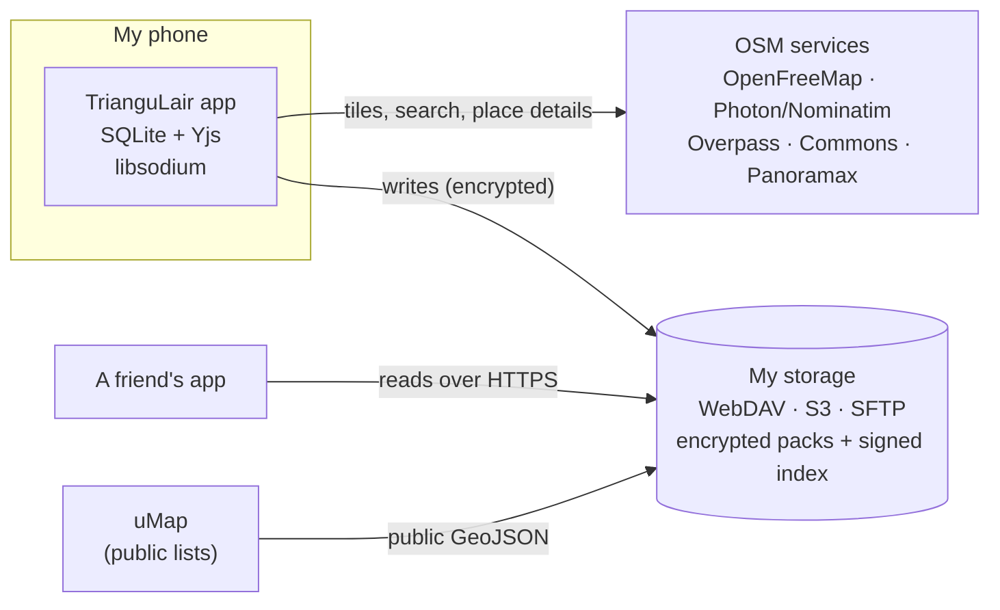

# TrianguLair — specification of the local-first, encrypted places app

> Source of truth for the project. Any change goes through a pull request on this file (see [CONTRIBUTING](../CONTRIBUTING.md)). Breakdown into tasks: [TASKS.md](TASKS.md).

Version of October 13, 2026.

## Summary

Project name: **TrianguLair**, a triple pun on "triangulaire" (French for "triangular"), triangulation (a good address is found by cross-checking the recommendations of several friends), and *lair*, a den or hideout (a private, encrypted corner). The capital L makes the pun visible and the spelling obvious. Technical identifiers are lowercase: `triangulair` (repository, domain, app identifier).

Yes, it is feasible, and with no server to maintain: a "my favorite places" local-first app whose content is stored encrypted on a storage chosen by the user (WebDAV, S3, SFTP or plain web hosting), and which uses only open standards (OpenStreetMap, GeoJSON, standard storage protocols, standard encryption).

The principle: each person has a single key. My app writes all my content, encrypted, to my storage. I send a friend an invitation link that points to this content; they send me back a return link with their key; I decide what their key can open. Their app reads my storage directly and decrypts only what I have authorized. The storage itself sees only unreadable data.

The price of this choice: no instant notifications (friends' additions appear at the next sync), no account directory, and a key that must not be lost. In exchange: no server to operate, no centralized moderation, and privacy that does not depend on the host.

Decisions made so far: Android and iOS apps in React Native, local-first, storage of your choice (WebDAV, S3, SFTP, HTTPS), per-person encrypted sharing with an invitation link and a return link; pins colored by tag with a white icon outlined in gray, color bands for places with several tags; collapsible filter bar that fades places outside the filter; practical filters drawn from OpenStreetMap; zones (neighborhoods, streets, free drawing) in addition to places; monthly check for closed places.

## Goals and non-goals

Goals:

- **No mandatory server**: the app works on its own; to share, an existing storage is enough: WebDAV (Nextcloud, NAS), S3, SFTP or web hosting.
- **End-to-end encrypted**: the storage never sees the content; each person has a single key, and the owner decides what it opens.
- **Interoperable**: open formats (GeoJSON), standard storage protocols (WebDAV, S3, SFTP, HTTPS), standard encryption, full plaintext export at any time.
- **No dependence on Google**: base maps, search and place data come from OpenStreetMap.
- **Parity with everyday place-saving apps**: save a place, tag it, find it on a map or in a list, share, see your friends' places.
- **Android and iOS clients**: a single React Native (TypeScript) codebase, published on the Play Store, App Store and F-Droid, for phones, foldables, tablets and iPad, and available on Apple Silicon Mac; connectable to any compatible storage.
- **No lock-in**: you can change storage whenever you want, the app copies everything over; plaintext GeoJSON export.
- **Free license**: MPL-2.0, compatible with the stores (see Legal and publication).

Non-goals (at least for v1):

- GPS navigation, detailed routing.
- Rated public reviews like Google/TripAdvisor.
- Sponsored content, influencer guides, monetization.
- Fully offline world map (only the cache of viewed zones).

## Architecture: local-first, storage of your choice, encrypted sharing

The app keeps all its data on the phone, copies it encrypted to a storage chosen by the user, and shares with each friend via their unique key. There is no project-owned server.

### Principle

- **Local-first**: the places database lives on the phone (SQLite); the app works without a network, except for the uncached base map and search.
- **Storage of your choice**: the app copies the content to a storage chosen by the owner (WebDAV, S3, SFTP or HTTPS, details below). The owner has read and write access to it, from all their devices. Without storage, the app works locally only, with no sharing.
- **Everything is encrypted before leaving the phone**: the storage, its host or anyone who accesses it sees only unreadable blocks.
- **One person, one key**: each user has a key pair created on their phone. The public key serves as identity; the private key never leaves the device, except in an encrypted backup. Technically, a master key derived from the recovery phrase certifies a sharing key, which can be replaced in case of theft without changing identity (see Loss and theft).
- **The owner decides**: for each place, zone, comment or list, the app wraps the content key for the public key of each authorized friend. Groups ("friends", "family") are only local shortcuts for ticking several people at once; nobody else sees them.
- **Friends read at the source**: a friend's app reads the owner's storage directly, read-only, and decrypts only what is opened to them. Nothing is sent or copied to a third party.

### Storage protocols

The owner writes with the protocol of their choice; their friends always read through a simple HTTPS address, included in the invitation link. Since everything is encrypted, this read address can safely be public. The read address is certified by the master key (it is part of the sharing certificate, see Loss and theft): friends read only at that certified address, never at an address that a link or a device chooses on its own. Connecting a storage for the first time and changing it therefore need the master key: the primary device, or the 12 words (the app asks for them during the storage wizard, which comes with the recovery kit step).

| Protocol | Write by the owner | Read by friends | Examples |
| --- | --- | --- | --- |
| WebDAV | Yes | Read-only share link, or public folder | Nextcloud, NAS, hosting providers |
| S3-compatible | Yes, with an access key limited to the bucket | Public HTTPS address of the bucket or of a CDN | Scaleway, OVH, Backblaze B2, AWS, MinIO, Garage |
| SFTP | Yes, with an SSH key | HTTPS address of a web server that serves the same folder | Personal server, shared hosting |
| HTTPS only | No: publishing by another means (export from the app, Git, sync tool) | Yes | Static pages (Codeberg Pages, GitHub Pages), personal site |

In the app, one adapter per protocol exposes the same operations (list, read, write, delete, get a file's version); the rest of the app does not know which protocol is used. To tell whether a file has changed, the app uses the ETag or the modification date depending on the protocol.

HTTPS-only mode suits someone who publishes rarely (a travel list, a guide); the other three allow automatic synchronization and use on several devices.

### Invitation link and return link

1. I send a friend an invitation link, through any messaging app or as a QR code. It is short (about 150 characters) and contains only what cannot be fetched: my public key, the read address of my content, a temporary invitation secret (valid for 7 days) that lets the invitee immediately see what I share with my friends, while waiting for me to accept their return link (its access is removed upon acceptance or expiry), and the expiry. Everything else (my sharing certificate, signed by the master key, which certifies the read address, and the list of devices declared lost) is read from my signed index at that address. Before the link is shared, my device publishes an index that lists the invitation (a hash of it, see Data model): this listing, signed by a device that the master key has not revoked, is what proves the link comes from me. The device that creates an invitation also signs its record in the recovery vault, with its own device certificate, so that my other devices list only invitations really created by one of my devices that is not declared lost; an invitation lasts at most 7 days. Inviting a friend or answering an invitation never requires the 12 words. Inviting requires a storage: without one, there is no index to vouch for the link, so the app offers the storage wizard first.
2. Their app opens the link, reads my index only at the address certified by my master key, checks that it is mine and that it lists the invitation, then saves my key and shows my content; it then generates a return link containing their public key and sharing certificate (with the certified address of their own content if they also share).
3. They send me this link; I open it and choose what they can see (by default: everything I share with "friends").
4. My app adds the wraps for their key; they see my content at their next sync. If we both share, the exchange works in both directions.

Protecting the invitation (decided after the crypto review, T-002):

- **One answer per invitation**: an invitation accepts a single return link. If several answers arrive (the link was forwarded or intercepted), none is accepted automatically: the app shows them all with a warning and I choose. The app keeps the invitation (in the recovery vault, so every device sees it) until 7 days after its expiry, even after accepting an answer: if another person answers later, it warns that the first answer may have come from an impostor and offers to revoke it.
- **Late answers**: an answer created before the invitation expired is still accepted for 7 days after expiry (the friend opened the link on day 6, I open the app on day 8). During that grace period a second answer still triggers the "first answer may be an impostor" warning. After it, answers are no longer opened. The creation date of an answer is claimed by whoever made it, so anyone who kept the link could date an answer before expiry: an answer opened after expiry is flagged and never accepted automatically, even when it is the only one; the app asks me ("Léa answered after the invitation expired") and suggests comparing the safety code.
- **Re-encryption on acceptance or expiry**: when the invitation is accepted or expires, the content it opened is re-encrypted with new pack keys (not merely re-wrapped), so someone who kept a copy of the link can no longer read anything new.
- **Optional verification**: each contact shows a safety code computed from both identities (12 groups of 5 digits, or a QR code to scan). Comparing it is not mandatory: each person can mark a contact as "verified" once they have really compared the code, by phone or face to face; until then the contact shows an "unverified" badge, on the request, in the contact card and wherever the friend appears. Marking is a personal declaration, never sent to anyone. If a verified contact's identity changes, the mark is removed and the badge comes back.
- **Short link**: the invitation is encoded in a compact binary form of 50 bytes plus the read address: about 150 characters with the `https://example.org/i#` prefix and a typical address, at most 200 characters for an address of up to 80 characters, so that its QR code stays small (version 10 or lower). The number of devices declared lost does not change its size. The return link, which goes through messaging, keeps the full form (about 530 characters plus the address of the responder's content, and 43 per device they declared lost), because most invitees answer before having a storage.
- **How the link is bound to me**: the link itself is not signed. My signed index lists a hash of each open invitation, covering every field of the link (my key, the invitation key, the rotation, the expiry and the read address); the invitee's app accepts the link only if the index found at the address certified by my master key is signed for the key named in the link and lists the invitation. A forged link (another key, another address, a changed expiry) is therefore refused, not redirected. The list is padded with dummy entries that all my devices derive in the same way from a secret they share (the vault data key), and that come and go at their own pace (each within 1 to 7 days) like real invitations, so that the public index shows only a rough bucket (4, 8, 16… entries), present even when no invitation is open. What remains visible to someone who polls my index: when it is republished (inviting requires a publication), when the bucket changes, and occasionally that an entry which comes back was a dummy. The listing is kept until expiry, also after acceptance (so that a late second answer can still arrive), and dropped at expiry. A device lists only invitations whose vault record is signed by one of my devices not declared lost, lasts at most 7 days and was created under my current sharing certificate; a record that breaks these rules (for example one planted by a stolen phone) is skipped and reported, and never prevents publishing the index. A genuine record that cannot be listed yet (the device that created it has a clock a few minutes ahead, or already holds a newer certificate than the publishing device) is kept and listed later; only a record that is invalid, made by a device declared lost, or expired (after the grace period) is ever removed from the vault.
- **Any key change cancels open invitations**: an invitation is listed only under the sharing certificate it was created with. Every change of that certificate (a declaration of loss, a storage move, a new sharing key) therefore cancels the invitations open at that time, whatever copy of the vault a device merges later: an invitation that comes back from an older copy is never listed again. The app tells me which links were cancelled and who had not answered yet, so I can send them new ones ("Your pending invitations were cancelled; send new ones"). Inviting again takes a few seconds; a storage move or a key change is rare.
- **Freshness**: the link carries the rotation of my sharing certificate at the time of the invitation. The invitee's app reads my index only at the certified address (or at a newer certified address, if the old storage holds a signed redirect), refuses an index older than that rotation, refuses the link if the index has a later rotation (the invitation was cancelled by a key change) and refuses it if the index does not list it. A device declared lost can therefore no longer pass as me to a new contact: it cannot publish an index that friends accept, the address cannot be redirected elsewhere since it is certified by the master key, and the index published at the declaration no longer lists any invitation that was open at the time. For a return link, on my side, my app reads the responder's index at their certified address, refuses an index older than the certificate in the answer, and refuses the answer if its device is revoked there. If the person is already a contact, a link never resets what the app already knows about them.
- **Direct recipient**: content opened to an invitation is wrapped directly for the invitation key, never through a recipient group, so that re-encryption really cuts off the link. Every key reachable from that content (a photo key, a link-only list key) is renewed too.

When meeting face to face, an exchange of QR codes replaces the two links: the keys are exchanged directly, without an invitation key, and the contact is marked as verified automatically.

### Asymmetric relationships

Each direction of the relationship is independent:

- **Following someone**: my app reads their storage and displays what they have opened to me. They are the one who decides, since they need my key.
- **Being followed**: I have opened content to someone, with their key.
- One does not imply the other. The return link is therefore a request ("Paul would like to see your places") that the recipient accepts, partially accepts or ignores.
- Following a public list or one received by link asks nothing of anyone, neither key nor consent.
- Each contact shows two switches: "I see their places" and "they see my places", and a "verified" / "unverified" badge (see Invitation link and return link). The word "friends" in the app refers to the people I follow; the filters and the What's new view apply to them.

### Encrypted sharing

- Each item (place, zone, comment, photo) is encrypted with a random key.
- Items that have exactly the same recipients share a pack key, wrapped once for each recipient: the content stays light even with many friends.
- Wraps do not carry the recipient's name: a friend's app tries its key, and nobody can read my contact list on the storage.
- Everything is signed with my key: my friends' apps verify that the content comes from me and has not been modified by the storage.
- Removing someone: their wraps disappear and the affected pack keys are renewed; their app can no longer decrypt this content and erases it from its cache at the next sync; only copies deliberately made (screenshot, export) or a purposely modified app escape this.
- "Link-only" list: a key specific to the list, placed after the # in the URL, a part that is never sent to the server; the link opens in the app.
- "Public" list: published in plaintext (GeoJSON) on the storage, readable by all, including in uMap.

### Organization on the storage

- A small signed index, encrypted packs (by batch of places or by geographic zone) and photos as separate files, also encrypted.
- Only modified packs are rewritten; friends ask "has it changed?" (ETag header) and download only what is needed. The storage's ETag is only a cache hint: integrity always comes from the content hash recorded in the signed index.
- Pack files are named after the hash of their content and never modified: a new version of a pack is a new file. The pack's logical identifier is stored inside the encrypted content, so the files themselves do not reveal which pack they are a version of; comparing two successive indexes still shows which file replaced which when a single pack changed, which the app blurs by grouping replacements.
- The index is the file `index.json` at the read address (during a major format transition, newer majors are published next to it as `index.v<N>.json`, see Format versions). It is public: it reveals the number of devices declared lost, the number of publications (and so when I invite, since an invitation needs a publication), the number of packs and a rough bucket of the number of open invitations (padded), never their content, recipients or invitees.
- Friends' content is kept in cache in the app (decrypted in the local database, itself protected by the phone's encryption) for instant display. It is refreshed on opening, regularly as long as the app stays open, and on demand (pull to refresh) , and ends just after the app is closed; no periodic task. By comparing the old and new versions, the app knows exactly what has changed: this is what feeds the What's new view.
- Several devices of the same user write to the same storage; an automatic merge technique (CRDT, Yjs library) avoids conflicts.
- The storage still sees file sizes and update dates; the app adds padding to limit what can be inferred from them.

### No duplicates, lightweight storages

In the app, a place exists only once, regardless of how many friends have saved it:

- Places are identified by their OpenStreetMap identifier: if three friends have the same restaurant, the app keeps a single place card and three records (one per person, with their comment, tags, status). On the map, a single pin; in the card, "3 friends".
- For a manually placed point (place absent from OSM), the app offers to merge when two points are within about thirty meters of each other with a similar name; the user confirms.
- Identical zones (same OSM neighborhood) are recognized the same way; drawn zones remain distinct.
- "Add to my places" from a friend's place creates only my own record, which points to the same place card.

Each storage contains only its owner's content:

- Nothing is copied to others: my friends read my storage, I read theirs.
- Packs contain only personal data (OSM identifier, name, coordinates, tags, comment, status, price), never the OSM record (opening hours, free photos, practical info), which each app fetches and caches itself. Order of magnitude: a few hundred bytes per place, so under 1 MB for 1,000 places.
- A pack key is wrapped per group of identical recipients, not per place: adding friends barely increases the content size.
- Optional personal photos, recompressed on upload (about 1,600 px wide, WebP or AVIF format) with a separate thumbnail; friends download the full photo only when opening it. Format caps: 2,048 px a side and 1.5 MiB for a photo, 512 px and 128 KiB for a thumbnail; the app never refuses a photo for its size (it lowers the quality, then the size, until it fits), and readers refuse larger files.
- Drawn zones are simplified before saving.
- The app occasionally merges small update packs and deletes files that have become unnecessary; with Nextcloud, it recommends limiting the version history on its folder.

On the phone side, the friends' cache has an adjustable maximum size: their data stays in cache, their photos are evicted first when the limit is reached.

### Format versions

Goal: friends who do not have the same app version continue to read each other, with no server to coordinate.

- **Two version levels** in the index and every signed or encrypted JSON structure: `version` is the major version (incompatible changes: a reader refuses a major it does not know), `minor` (absent means 0) marks compatible additions. Binary structures (invitation link, return link, sealed keys, transfer) carry only a major version.
- **Ignore the unknown**: an app silently ignores the fields and item types it does not know when the document declares a higher minor version than its own. The signature (or the encryption) covers the whole document, unknown fields included. Without a higher minor, an unknown field is an error. When it rewrites a document (the case of two devices of the same user with different versions):
  - **content documents** (places and lists in the Yjs document, the recovery vault: its records, their unknown fields and its free-form app part) keep the unknown fields and records as is, with the higher minor version;
  - **documents derived from the owner's current state** (the signed index above all) are written again from that state: an older device drops the fields it does not know and writes its own minor version. It never copies them, because it cannot tell whether they are still true (an open-invitation list copied blindly would outlive expiry, or a declaration of loss). The next newer device to publish puts them back.

  A future field that an older device must neither drop nor copy needs a new major version.
- **Except what affects security**: a field whose meaning matters for security is listed in the document's `crit` list; an app that does not understand a listed field refuses the whole document ("Update the app to see Léa's places"), like JWS/JWE. Such a field must not be dropped by an older device; if it cannot be, the change is a new major version.
- **Everyone announces what they can read**: the index publishes the list of versions that its owner's app understands. When writing, the app chooses for each pack the most recent version that all its recipients can read. No server needed: the information is already in the indexes everyone reads.
- **Gentle transition**: during a major version, the app writes in both the old and new format as long as a friend has not updated, within a limit of one year. The index of the new major is published under its own name next to the old one (`index.v<N>.json` beside `index.json`); an app reads the highest major it understands.
- **Clear message** when content remains unreadable: "Update the app to see Léa's places".
- **Identified algorithms** in each pack (encryption, wrap, signature): they can be changed later, for example to quantum-resistant encryption, without breaking old content.
- **Guaranteed reading** of old formats for at least two years after their replacement.
- **Public specification** of the format, versioned, with test vectors, and automated cross-reading tests between the latest app versions.

### What we accept to lose

| Without a server | Consequence | Mitigation |
| --- | --- | --- |
| No instant notifications | Friends' additions appear at the next sync | Sync on opening and on demand |
| No directory | You cannot find anyone by username | Invitation links, QR codes |
| Private key on the phone | Losing the key means losing access | Recovery phrase and encrypted backup on the storage |
| A storage is needed to share | A storage is required (WebDAV, S3, SFTP) | Nextcloud and S3 are offered by many hosting providers; local-only possible without sharing |
| Reading through a share link | The friend must be able to read the folder | Read-only share link, or public folder: harmless since everything is encrypted |

## Interoperable standards and formats

All building blocks use an existing standard; the only project-specific format is the organization of the encrypted packs, documented and open.

| Need | Chosen standard | Note |
| --- | --- | --- |
| Storage | WebDAV (RFC 4918), S3 API, SFTP, HTTPS for reading | One adapter per protocol; friends always read over HTTPS |
| Content encryption | XChaCha20-Poly1305 (libsodium) | Proven library, available in TypeScript |
| Key wrapping | X25519 (libsodium sealed boxes), structure inspired by JWE (RFC 7516) | One public key per person |
| Signature | Ed25519 | Content authenticity |
| Multi-device synchronization | CRDT (Yjs) | Automatic merging of modifications; pure JavaScript, so it runs in React Native's engine (Hermes) |
| Sharing links | URL with key in the fragment (#) | The fragment is never sent to the server |
| Place data | OpenStreetMap (ODbL license) | Name, category, hours, cuisine, diets, terrace, reservation, entry price, website, phone; free photos via Wikimedia Commons and Panoramax; neighborhood boundaries and street paths for zones |
| Place identifiers | OpenStreetMap (node/123, way/456) | Name and coordinates copied locally |
| Base maps | Vector tiles (MVT), PMTiles, MapLibre style | A single file, hostable statically |
| Address search | Nominatim / Photon API | Public or self-hosted services |
| Export / import | GeoJSON (main), GPX, KML, CSV | Openable in uMap, QGIS, Google My Maps, Organic Maps |
| Import from Google | Google Takeout "Saved places" (GeoJSON) | To migrate your favorites |
| Import from Mapstr | Mapstr export: a ZIP with `mapstr.csv` and `mapstr.geojson` | Checked on a real export (T-009); columns in "Importing your places" |

A known limitation: OpenStreetMap identifiers are not perfectly stable (an object can be deleted or recreated). Each saved place therefore also keeps its coordinates and name as a local copy, the OSM ID being only an enrichment link.

## Features

The MVP covers solo use and sharing between friends via WebDAV storage and per-person encryption.

### MVP (v1)

- [ ] Identity creation (key pair on the phone, recovery phrase), profile (name, avatar); optional connection to a WebDAV storage
- [ ] Full-screen map with your places and zones, clustered when zoomed out
- [ ] List view with sorting (recent, distance, name) and text search
- [ ] **Add a place**: the add screen immediately displays the known places around the visible area (or my position), sorted by increasing distance; then search by name (Photon/Nominatim), long press on the map, or current position
  - [ ] Each suggested place indicates whether it is already in my places or saved by friends
- [ ] **Add a zone**: existing neighborhood, one or more street segments, or free drawing (by points or by finger painting) — details below
- [ ] Place card automatically enriched: practical info, free photos and opening hours when they exist (details below)
- [ ] Personal tags with color and icon, sub-tags possible ("Restaurant › Neapolitan pizza")
- [ ] **Filter bar** on the map and the list: categories, sub-filters of the category (types of cuisine, museum, shop), practical criteria from OSM (open now, happy hour, terrace, diet, reservation, free entry, entry price), status, visibility, price level, text search; collapsible into a one-line summary, state remembered
- [ ] Filtered display: matching pins stay in color, the others are grayed out, faded and smaller
- [ ] Comment with its own visibility: private, friends or public (friends by default; "public" makes it visible in public lists); status "to try / tried / favorite", my rating (1 to 5 stars, seen by my friends but not in public or link-only lists), price level (€ to €€€€), personal photos
- [ ] **Sharing a place**: shared with friends by default; the Sharing section of the card lets you make it private, or add it to one or more sharing lists; a private place never appears for others, nor in the "friends" counters, nor in any list
- [ ] Follow and share, independently in each direction: invitation link, request by return link, QR code face to face, or simple subscription to a public or link-only list
- [ ] **Friends' places**: "Also at my friends'" filter and "Whose places" (mine, one friend, several or everyone, remembered); a small dot in the friend's colour on their pins; "3 friends" mention in the list, the card and the add screen, which opens who saved it, when, and their comments, within the limit of what each has made visible; What's new view that lists what has changed at friends' since the last visit
- [ ] **Lists**: subsets to share, defined by a saved filter, which updates itself, or by a manual selection (details below)
- [ ] **Visibility of sharing lists**: set in the list itself: public (visible to all) or accessible only with the link; a list never displays a private place
- [ ] **Closed places**: automatic monthly check and flagging (details below)
- [ ] Sharing a place, a zone or a list by web link (viewable without an account for a public or link-only list)
- [ ] Open directions in the phone's navigation app, and open the place in Maps or Google Maps to view reviews and photos
- [ ] Import from Google Maps, Mapstr, Pin Drop and others (Takeout, CSV, KML, GeoJSON); full GeoJSON export
- [ ] Android and iOS apps (React Native) + "View on uMap" link for public lists

### Creating a sharing list

A list combines criteria; any new place that meets them enters it automatically.

- **Categories and tags**: one or more (Restaurant, Bar, "brunch"…), with the usual sub-filters and statuses (tried, favorite…).
- **Zones, by name**: search for a city, a region or a country; boundaries come from OpenStreetMap (administrative boundaries), several zones possible ("Lyon" + "Portugal").
- **Zones, by outlining**: zoom out and circle part of the map with a finger, with the same tools as for drawing a zone (by points or by painting).
- **Exceptions**: remove or add a place by hand, without breaking the filter.
- **Preview**: map of the chosen zones, retained places in color and others faded, and number of places before confirming.
- **Sharing**: link-only or public, as for any list.

Technical: a zone by name is saved as an OSM identifier (administrative boundary relation) plus a simplified shape, to stay light even for a country; an outlined zone is a simplified polygon. The list filter is stored as JSON (tags, categories, statuses, zones, exceptions).

### Following a list without following the person

A public list or one received by link can be followed without an account, without a request and without a personal key: the link is enough.

Opening a list link:

- **App installed**: preview (map and list of places, author's name, update date), then three actions: "Follow this list", "Add places to my places" (one by one or all), "Ask to follow the author" (sends a request by return link).
- **App not installed**: a public list is displayed in uMap; a link-only list redirects to the store page.

Once followed:

- The list appears in a "Followed lists" panel, each with a switch to display it on the map.
- Its places are displayed with the same style as friends' places, and respond to the same filters; a "Source" filter lets you choose my places, my friends, or a given list.
- Additions and changes to the list appear in What's new.
- Places already present in my places or my friends' are not duplicated: same place card, with the mention of the list.

Author side:

- They do not know who follows their list: reading is done directly on their storage, without registration.
- To cut off access to a "link-only" list, they generate a new link; the old one stops working and subscribers see "This link no longer works".

Technical: the list carries its author's public key and signature, which makes it possible to verify that it has not been modified, and to automatically attach it to the author if they are followed later. For each followed list, the app keeps its address, the link key, the author's key and the last version read. Limitation: the host of the author's storage sees the IP address of those who read the list, as with any web page.

### Viewing without the app

In v1, no custom web page:

- **Public list**: already published as plaintext GeoJSON on the author's storage; the app offers a "View on uMap" link, which opens the list on a uMap web map (public instance of OpenStreetMap France or another instance). uMap reads remote data, going through its server if needed, which avoids CORS issues, and updates when the file changes. The author's colors are included in the GeoJSON in a form that uMap can read, at least in part.
- **"Link-only" list**: encrypted, therefore unreadable by uMap; the link opens the app if it is installed, otherwise the store page.
- Accepted limitations: uMap's own rendering (not our pins or our filters); the uMap server sees the data, which is not a problem for a public list.

In v2, if encrypted sharing outside the app is missing: a custom static web page that decrypts in the browser (key in the URL fragment), with map, list, place cards and calls to install the app; hosted on the author's storage when it can serve web pages, or on static hosting run by the project (CORS reading to be verified, especially for Nextcloud).

### Editing and deleting

Editing:

- Everything is edited from the card (tags, comment, status, price, photos, sharing, geometry of a zone); the change goes out at the next sync.
- At friends', only meaningful changes appear in What's new (new comment, switch to "tried" or "favorite", new photo), not minor touch-ups (color of a tag, fixing a typo).
- Two devices editing the same place are merged automatically (CRDT); if one deletes while the other edits, the deletion wins, and the place remains recoverable from the trash.

Deleting:

| Action | On my side | On my friends' side |
| --- | --- | --- |
| Delete a place, a zone or a comment | Trash for 30 days, synchronized across my devices and restorable | Disappears from their cache at the next sync |
| Remove a friend's access to a place or a list | Nothing changes | Disappears from their cache at their next sync |
| Delete a list | The places remain, only the list disappears | The link displays "This list no longer exists" |
| Remove a friend | Their places disappear from my cache, they lose all their access | They no longer see my updates |
| Delete all my content | Local erasure and of all files on the storage | Their apps erase my content from their cache |

Mechanics:

- A deletion leaves a signed marker (identifier and date) in a pack; friends' apps erase the corresponding item from their cache.
- Safety net: the index lists all existing items; an app that returns after a long absence erases from its cache everything that no longer appears in it, even if the markers have been purged in the meantime (they are kept for six months).
- Deleting all your content: the app erases the files from the storage, but leaves for a few months a signed "content deleted" marker so that friends' apps empty their cache, then removes it. The recovery kit then becomes useless, which the app indicates.
- If I have added to my places a place seen at a friend's, my record is independent: it remains if the friend deletes theirs.
- Discreet reminder when removing access: the content disappears from the friend's app at their next sync, but a deliberately made copy (screenshot) cannot be taken back.

### Importing your places

Import is primarily meant to bring over users from Mapstr, Pin Drop or Google Maps without re-entering anything; it is therefore part of the MVP.

| Source | Format | Status |
| --- | --- | --- |
| Google Maps | Google Takeout (GeoJSON, CSV) | Known format |
| Mapstr | ZIP export: `mapstr.csv` (`date,name,address,icon,userComment,rating,tags,photos`: US dates, `#`-separated tags, photo URLs, no coordinates) and `mapstr.geojson` (points with `name`, `address`, `icon`, `userComment`, `tags` as `{name, color}`) | Known format (checked on a real export, T-009); the CSV or the GeoJSON alone is accepted too. Whether the export needs the paid plan is not known |
| Pin Drop | One JSON file: `data` mixing `tag` (`id`, `name`, `color`, `icon`), `pin` (`name`, `lat`, `lng`, `description`, `tag_ids`, `date_dropped`, `favourite`, `wishList`, `isSecret`, `address`, `media`/`heroImage` photos on Pin Drop's server) and `message` items | Known format (checked on a real export, T-009). Secret pins are imported private; photos are downloaded only if asked in the preview |
| Other apps, spreadsheets | Generic CSV, with a column-mapping wizard (name, coordinates or address, note, tags) | — |
| This app | GeoJSON | Known format |

Processing:

- Each imported place is matched to an OpenStreetMap place by its name and position, or by its address. Confident matches are automatic; doubtful ones are presented for validation, on the map; with no match, the place becomes a manually placed point.
- The source's tags become my tags, with their colors if the export contains them; notes become comments; known statuses (tried, to try) are carried over.
- The source's rating becomes my rating (1 to 5 stars). Mapstr does not document its scale, so it is decided per file: ratings up to 5 are stars (decimals rounded); a file with ratings above 5 but none above 10 rates out of 10, and each rating is halved and rounded; `0` means "not rated"; anything else is left out and counted in the preview. A place already in my places gets the rating only if it has none, even when I do not merge the file into it, and undoing the import removes it again; re-importing the same file changes nothing.
- No duplicates: re-importing a file or importing from two sources never creates a place twice. Rows of one file for the same place are folded; a place already in my places (same OSM object, or same name within about 50 m) is shown as "already in my places" and left as it is, unless I choose to add the file's tags and comments to it.
- A tag of the source that is really a status ("À essayer", "to try") becomes the status. Practical criteria (terrace, vegetarian, takeaway) come from OpenStreetMap, so such tags stay tags.
- Places that may no longer exist according to OpenStreetMap (the matched object carries a closed signal of "Closed place detection", or the source gives a category and OSM has no place of that name nearby) are counted in the preview; I keep them, flagged "maybe closed", or leave them out. Nothing is dropped silently.
- Final summary: number of places imported, linked to OSM, to check, ignored; import can be undone in one gesture for a few days.

### Closed place detection

A background task rechecks every saved place once a month, and also when its place card is opened if the last check is more than a month old. It marks the place "maybe closed" at the first signal; the user confirms, and nothing is deleted automatically.

Signals detected:

| Source | Signal | Reliability |
| --- | --- | --- |
| OpenStreetMap | Object deleted from the database | High |
| OpenStreetMap | Tag switched to a lifecycle prefix: `disused:shop`, `was:amenity`, `abandoned:` | High |
| OpenStreetMap | Name or category changed at the same location (new business) | Medium |
| OpenStreetMap | Opening hours removed or set to `off` | Low |
| OpenStreetMap | At import: no OSM place of that name near the position the source gives, although it gives a category | Low |
| Users | You or a friend report "closed" | Medium, high from 2 reports |
| Friends | A friend's "closed" report, read from their shared content | Medium |

What happens next:

1. The place gets a "maybe closed" badge on the map and in the list, with the reason and the date of the signal.
2. When the app is opened, a grouped notice (at most once a month) lists the places concerned.
3. The user confirms "closed", "still open" or "moved" (with the new address).
4. A closed place stays in the history with its comments, hidden by default through the status filter; it is removed from public lists.
5. If the information comes from a user and not from OSM, the app offers to correct it in OpenStreetMap, which benefits everyone.

Technical side: the app itself queries the Overpass API, in small batches of identifiers when the app is opened, at most once a month per place; a very light load for OSM services.

### Place card: info, photos, opening hours

When a place is added, the app fetches everything available from free sources and caches it; empty fields are simply hidden.

| Data | Source | Note |
| --- | --- | --- |
| Category, cuisine, address | OpenStreetMap | Determines the default icon |
| Phone, website, e-mail, social networks | OpenStreetMap | Direct action buttons (call, open the website) |
| Opening hours | OpenStreetMap (`opening_hours`) | Interpreted with the opening\_hours.js library: "Open, closes at 10 pm", public holidays, and the "open now" filter |
| Accessibility, terrace, Wi-Fi, vegetarian | OpenStreetMap | Shown as pictograms |
| Photos of the place | Wikimedia Commons and Wikidata (`image`, `wikimedia_commons`, `wikidata` links in OSM) | Free photos, with the author's credit displayed |
| Street photos | Panoramax (free), Mapillary as an option | View of the façade when no photo exists |
| User photos | You and your friends | Visible according to the place's visibility |
| Description | Wikipedia via Wikidata, if the article exists | Mainly for monuments and museums |

No photos are fetched from Google or from the businesses' websites: they are protected by copyright. Opening hours and info are refreshed at the same time as the monthly closure check.

### Filters based on source data

The practical filters rely on OpenStreetMap fields; each place category has its own set of filters.

| Category | Filter | OSM field | Display |
| --- | --- | --- | --- |
| All | Open now / open at a chosen time | `opening_hours` | "Open, closes at 10 pm"; public holidays handled |
| Restaurants, bars, cafés | Happy hour in progress | `happy_hours` | "Happy hour until 8 pm" |
| Restaurants, bars, cafés | Terrace | `outdoor_seating=yes` | Yes / no / unknown |
| Restaurants | Type of cuisine | `cuisine` (several values possible) | Sub-filters: burger, Italian, Chinese, Indian, regional… |
| Restaurants, shops | Diet | `diet:vegetarian`, `diet:vegan`, `diet:gluten_free`, `diet:halal`, `diet:kosher` | "Options" or "exclusively" depending on the value (yes / only) |
| Restaurants | Reservation | `reservation` | Recommended, required, possible, no |
| Museums, monuments, sites | Open now | `opening_hours` | As above |
| Museums, monuments, sites | Free / paid admission | `fee` | Free / paid / unknown |
| Museums, monuments, sites | Admission price | `charge` (e.g. "12 EUR") | Amount shown in the place card, "under €X" filter when it is filled in |
| Museums | Type of museum | `museum` (art, history, science…) | Sub-filters |
| Shops | Open now | `opening_hours` | As above |
| Shops | Type of shop | `shop` (bookshop, clothing, cheesemonger…) | Sub-filters |
| Shops | Second-hand, organic | `second_hand`, `organic` | Yes / no / unknown |

Price level for restaurants and bars: absent from OSM (a tag proposal was abandoned), so it is entered by the user from € to €€€€, with the friends' average when they have filled it in.

Common rules:

- A filter only appears if enough displayed places have the information, with their count.
- A place without the information is not silently excluded: it appears in an "unknown info" group, faded like places outside the filter.
- The place card offers to fill in missing information, and to contribute it to OpenStreetMap if the user wishes.

### Zones: neighborhoods, street segments

A zone can be saved instead of a point: it has the same tags, notes, photos, visibility and filters as a place, and is displayed as a filled area or a line in the color of its tag, with a badge at its center.

Three ways to create one:

| Mode | Gesture | Geometry | Source |
| --- | --- | --- | --- |
| Existing neighborhood | Tap a neighborhood on the map or search for it by name | Polygon | OSM boundaries (`place=neighbourhood`, `quarter`, `suburb`), copied locally |
| Street segment | Tap a street, then drag two handles to choose the start and the end; "Add a segment" to chain others, contiguous (the path follows the streets through intersections) or separate | One or more lines following the streets | Street path in OSM, cut between the two points |
| Freehand drawing | Two variants. By points: place the vertices one by one, tap the first point to close, then move or add points. By painting: shade the zone with a finger like a marker (adjustable thickness, eraser), and the app derives a smoothed shape | Polygon | User input; the painted variant is marked "fuzzy outline" |

Display:

- Zone: transparent fill (about 20%) with a 2.5 px outline in the color of the main tag. Painted zone (fuzzy outline): no outline, but a gradient edge in three rings of decreasing opacity, to signal an approximate boundary.
- Street segment: thick transparent line along the street, with a thin solid line at the center.
- Zone icon: a square badge with rounded corners (same size, colors, icon, border and multi-tag bands as pins), but without a tip, to signal an area and not a precise point. It is placed at the most central point inside the shape (even for an L-shaped or crescent-shaped one), and at the middle of the longest segment for a street. When zoomed out, only the badge remains.
- Outside the filter, the zone fades like pins.
- A zone's card also lists the places saved inside it (your own and those of visible friends).
- No opening hours or closure detection for a zone.

Technical: the local database (SQLite with a spatial extension) accepts a point, line or polygon, with an edge indicator (sharp / fuzzy). A painted zone is computed on the phone: each stroke is widened to its thickness, the strokes are merged, then the shape is smoothed and simplified (Turf.js library); only the final shape is saved. In exports as in shared packs, the zone is a GeoJSON Polygon, LineString or MultiLineString object (several segments).

### v2 — advanced sharing

- [ ] Collaborative lists with several authors (each writes to their own storage, the app merges)
- [ ] Other storage options: Remote Storage, automatic publishing via Git
- [ ] Migration from one storage to another in one gesture
- [ ] History of granted accesses and automatic key renewal
- [ ] Home-made web page to browse without the app, including link-encrypted lists

### v3 and beyond — comfort

- [ ] Offline maps: download a region as PMTiles
- [ ] Suggested places: places from your friends near you
- [ ] "Nearest places" widget
- [ ] Reactions ("likes") on friends' places
- [ ] Sharing from Google Maps to the app (Android intent, iOS share extension)
- [ ] Easier contribution to OpenStreetMap (report wrong opening hours)

## Features of existing place-saving apps: what we port

Of the 25 features identified in existing place-saving apps, 13 are carried over from v1, 1 in v2, 5 later, and 6 are dropped because they rely on commercial partnerships, monetization or proprietary AI, or add nothing to the intended use. The Decision column can be edited.

| Feature | Decision | In our app |
| --- | --- | --- |
| Save a place: search, around me, point on the map | Yes, v1 | With the list of nearby places sorted by distance |
| Custom, colored tags, filter by tag | Yes, v1 | Extended to combinable filters |
| Personal comments on a place | Yes, v1 | Visibility chosen for each comment: private, friends or public |
| Personal photos | Yes, v1 | GPS metadata removed on upload |
| Practical card: address, opening hours, phone, website, photos | Yes, v1 | Via OpenStreetMap; fewer photos |
| See friends' addresses and comments | Yes, v1 | "Also at my friends'" filter, choice of which friends are displayed, details and comments in the place card |
| Private or public map, selective sharing | Yes, v1 | Finer-grained: visibility per place and per list |
| Sharing by link, even with friends without the app | Yes, v1 | Public lists viewable in uMap; link-only lists in the app |
| Directions via Google Maps, Citymapper, Uber | Yes, v1 | Opens the chosen navigation app |
| Import from Google Maps, Foursquare | Yes, v1 | Google Takeout in v1, other formats afterwards |
| Web version | Yes, v1 | Public lists via uMap in v1; home-made page in v2 |
| Follow friends | Yes, v1 | By invitation link and return link, or QR code |
| Plan a trip | Yes, v1 | Covered by lists filtered by zone |
| Official maps from magazines and influencers | Yes, v2 | Any user can publish a public list, viewable on the web; no partnerships |
| Scan an address from a photo (OCR) | Later | Useful but secondary |
| Collaborative map with several people | Later | Collaborative lists |
| Proximity alerts | No | Dropped: useless for the intended use, and they would require background activity |
| "Nearest places" widget | Later | Android and iOS |
| Offline use | Later | Places always available offline from v1 (local-first); offline maps by region later |
| Import from Instagram and TikTok | Later | Via the phone's share menu to the app |
| AI-powered personalized suggestions | No | Replaced by "my friends' places around me" |
| One-click table booking | No | Relies on commercial partnerships |
| Paid maps to buy | No | Outside the free model |
| Place limit on a free tier, paid subscription | No | Unlimited; the only limit is the space on your storage |
| Paid offer for restaurants, hotels, brands | No | Out of scope |

What the project adds: storage at home, end-to-end encryption, full export as GeoJSON, combinable filters based on OpenStreetMap (open now, terrace, diet, admission price…), lists defined by a filter that update themselves, zones (neighborhoods, street segments, freehand drawing), closed place detection.


## Interface

The interface adopts the visual conventions that make place-saving apps readable: pins colored by tag with one icon per category, a clear filter bar, and a place card that rises from the bottom of the screen. The icons and design remain original: we draw on the principles, not on another app's files or visual identity.

Pins on the map:

- **Shape**: round badge with a tip, solid color = color of the place's main tag, white icon outlined in dark gray at the center; 2.5 px white border plus a 1 px dark outline, to stay visible on every background (city, park, water, dark mode).
- **Icon**: the one chosen for the tag; failing that, the one for the OSM category (restaurant, café, bar, museum, shop…).
- **Size**: about 34 px by default, 40 px for the selected place, 24 px when zoomed out; icon at about 60% of the diameter (21 px at normal size), with a thickened stroke for legibility; touch target of at least 44 px in all cases.
- **Friends' places, whose map**: each friend has a colour, taken from the tag palette and chosen from their identifier (the same on every device), which I can change on their page. A pin saved by friends shown carries a small dot in each one's colour (about 8 to 10 px, white outline) at the top right of its head, my places included when friends have them too: up to 3 dots, then "+n". The dots keep their size in pixels on smaller pins (outside the filter) and do not change the clusters; the pin's spoken label says whose maps it is on. The count of friends is not written on the pin: the details (who, when, comments) are in the place card. An "Also at my friends'" filter highlights places my friends have too.
- **Statuses**: "maybe closed" is signaled by a small gray cross; other statuses go through filters, not through the pin's appearance.
- **Clustering**: when zoomed out, a bubble with the number of places, in the color of the majority tag.

Colors and categories:

- Vivid palette of 17 predefined colors: red #EF4444, pink #EC4899, fuchsia #C026D3, violet #8B5CF6, indigo #6366F1, blue #3B82F6, sky #0284C7, cyan #0891B2, turquoise #0D9488, green #16A34A, lime #65A30D, yellow #FACC15, amber #D97706, orange #EA580C, earth #A16207, slate #475569, ink #1E293B. The icon is always white, outlined in dark gray (#1F2937) of about 1 px on all colors, which keeps it legible even on yellow and gives a consistent look. This outline is drawn in the icon files themselves, not added by an effect. Any free color is therefore possible, including very light ones.
- Library of about 150 freely licensed icons, grouped by category (eat, drink, go out, culture, nature, shopping, services, travel): Maki and Temaki base (CC0), completed as needed.
- Each new tag gets a suggested color and icon based on its name ("sushi" → sushi icon), which can be changed.
- A place can have several tags: the upper half of the pin, where the icon sits, takes the color and icon of the main tag; the lower half, toward the tip, is cut into equal horizontal bands in the colors of the other tags (3 bands maximum, hence 4 tags displayed; beyond that, a small "+N" next to the pin). When zoomed out (24 px), the pin goes back to the main tag's color only. When a filter is active, the pin takes the color and icon of the filtered tag. Active filters: matching pins stay in color, the others turn gray, at about 35% opacity and smaller (28 px), to keep context without hindering reading; with no filter, all are in color. In the place card, all tags are displayed as pills; reordering them changes the main tag.

Others' tags: on my map, my vocabulary and my colors always apply; the tags of the people I follow attach to it as follows:

- **Through the common category**: each of my tags can be linked to OSM categories ("Restaurant" ↔ restaurant, fast-food); a friend's place in that category takes my color and my icon, whatever the name of its tag.
- **By name**: automatic matching of equivalent tags (capitalization, accents, plurals, common synonyms such as "resto" and "restaurant").
- **By manual mapping**: "Léa's 'Bouffe' = my 'Resto'", remembered and reused for all her places.
- **With no match**: the tag keeps the color and icon chosen by its author, as long as I don't change them for myself; it appears in a "My friends' tags" section of the filter panel (with its color and the author's name), where I can filter on it, recolor it for myself, link it to one of my tags, or adopt it in one tap. If its color is identical to that of one of my tags, the app flags it in this panel to avoid confusion.
- **Filters**: filtering on one of my tags includes friends' places that have a matching tag or the right category.
- **Followed lists**: option to display a list with its author's colors, when its formatting is part of the content (guide, travel recommendations).
- **Adding to my places** from a friend's place: tags pre-filled thanks to the mappings.

Main screens:

- **Map** full screen, search bar and filter bar at the top, "+" button to add. The filter bar shows the categories, then the sub-filters of the chosen category (types of cuisine present in your places, coming from OSM or from your sub-tags, with their count), then the practical criteria (also at my friends', vegetarian, open now), the number of matching places and a "Clear filters" button. The bar collapses into a single summary line (one pill per active filter, with a cross to remove it, and a "Filters (3)" button to expand again); it collapses by itself when the map is scrolled, and the chosen state is remembered. **Whose places** is the filter bar's first row: "Me" and each friend as chips (avatar or initial, in the friend's colour), to tick several; a long press shows only that person's places, and a panel holds the shortcuts ("Everyone", "Only mine", "Only my friends", "Only Léa"), a search and the number of places per friend. The choice is remembered on the device and never shows nobody; when my places are hidden, one of mine stays if a friend shown has it. The visibility filter ("Private", "Shared") applies to my own places.
- **Tag management**: each tag with its color, its icon, its number of places, its linked OSM categories and its mappings with friends' tags.
- **Place card** as a panel sliding up from the bottom: photo, name, opening status, colored tags, your note, then "On the maps of: Ben, Léa" with their dots (a name shows only that person's places), the friends who saved it and their comments.
- **A friend's page**: their colour, and "See their places on the map" (shows only theirs).
- **List**: same colored pills at the start of the line, distance on the right.
- **What's new**: friends' activity since the last visit (places added, comments, lists shared with me, closures reported), grouped by day, filterable by type and by friend; unseen items are marked with a dot. A "See on the map" button activates the "what's new" filter (other places are faded). Badge on the tab; no notifications, the news appears when the app is opened.

To produce in phase 0: mockups of these four screens and a board of icons and colors, to be validated before development.

## First launch

Principle: reach the map in under a minute. The key is created without asking anything, backup is offered when there is something to lose, and storage only when the user wants to share.

### Three entry points

| Entry | When | What happens |
| --- | --- | --- |
| **Get started** | New user | Standard flow below |
| **I received an invitation** | The app is opened from a friend's link (or the link is pasted after installation) | "Marie is sharing her places with you", then first name; her places shared with friends are displayed right away thanks to the temporary invitation key, without setting up any storage; the app prepares the return link to send back to her |
| **I already have my places** | New device or reinstall | Add from another device by QR code, or restore with the recovery phrase and the storage address |

### Standard flow

1. **Welcome**: one screen, the promise in one sentence ("Your places, at home, encrypted"), "Get started" button.
2. **First name and photo** (optional): what your friends will see. The key pair is created in the background meanwhile, with no dedicated screen.
3. **Location** (optional): explained before the system prompt ("to center the map, never sent").
4. **Import?**: Google Takeout, Mapstr, GeoJSON, or "Later".
5. **The map**, with a help bubble on the "+" button to add a first place.

### Later, at the right moment

- **Backup**: after about ten places or a few days, a "Protect your places" card offers to connect a storage (automatic encrypted backup), and to save one's recovery kit (12-word phrase, verified by asking for 3 words again, and the storage address) in a password manager or on paper (details below). Discreet reminder as long as nothing has been done.
- **Storage**: offered the first time the user wants to share (invite a friend, create a link-only or public list). Wizard per protocol:
  - Nextcloud: connection through the browser (Nextcloud Login Flow), which creates a dedicated app password; the app creates its folder and the read-only sharing link automatically.
  - WebDAV, S3, SFTP: form adapted to each protocol (address, username, password or key), plus the HTTPS read address if it differs.
  - HTTPS only: explanation of manual publishing.
  - Full test before validation: write, read, delete a test file, and check that the read address does respond from the outside.
- **First friend**: "Invite a friend" button that generates the invitation link, publishes the index that lists it, then opens the phone's share menu (or shows the QR code).

### Recovery kit

To recover everything after a loss, two items are enough, easy to store in a password manager (KeePass, Bitwarden, Apple Keychain…):

- **The recovery phrase** (12 words): it recreates the key.
- **The storage read address** (HTTPS): it leads to the encrypted content.

Everything else is stored, encrypted, in a "recovery vault" on the storage: storage write credentials, list of friends and their keys, groups, settings. The vault data is encrypted with a random vault data key, sent to each device like the sharing key, in the same sealed package (so every device can update the friend list) and renewed when a device is declared lost; the vault itself also keeps the current sharing key and vault data key, encrypted with a key derived from the recovery phrase, which no device keeps. On restore, the app recreates the key, reads the vault and rebuilds everything. If the storage credentials have changed since, the app asks for them again.

The vault records that the security rules depend on have a fixed format (crypto package, `vault.ts`), padded to hide their size:

- **Friends' keys**: for each contact, their sharing certificate (key and certified read address) and the "verified" mark.
- **Last index seen per contact**: a compact anchor (rotation, sequence number, hash), so that a restore does not fall back to trusting whatever index is served first.
- **Open invitations**: the invitation secret, its dates (at most 7 days apart), the read address written in the link, the certificate of the device that created it and that device's signature over all of these, every answer received and the accepted one, kept until 7 days after expiry, so that any device can keep listing it in the index until expiry, warn about a late answer and re-encrypt at expiry. The signature lets every device check who created an invitation before listing it: a stolen device can write to the vault until the declaration, but it cannot write an invitation in another device's name or make one last longer.
- **Retired identities**: identities that announced a move, never trusted again.
- **App data**: storage credentials, groups, settings, free-form.

Two devices that write the vault at the same time merge their versions (newest anchor per contact, union of answers and retired identities). A merge may bring back invitation records that a declaration of loss removed (from a copy made before it); they are never listed again, since they belong to an older sharing certificate (see Invitation link and return link). When more than 16 answers to one invitation are gathered, the answers that open and verify for it are kept first, one per responder (the accepted one, then the others), so that junk written by a stolen device cannot push out the answer of a real second person. A device with an older app version keeps the fields and records added by a newer version (and the higher minor version) when it merges and saves the vault.

Every device holds the vault data key, so a stolen device can write anything into the vault until the declaration, and what it wrote is carried over when the vault is saved with the new key. A vault field that a future version gives a security meaning must therefore not be trusted on the vault data key alone: it must be signed by the device that wrote it, with its device certificate (as invitation records are), or it needs a new major version of the vault.

Kit export formats, to choose from:

- **Password manager entry**: share to the app of your choice (KeePassDX, Strongbox, Bitwarden…) with ready-to-use fields: title, phrase in the password field, address in the URL field, key fingerprint and protocol in the notes.
- **Copy to the clipboard**: the two items, field by field, to paste into any manager; clipboard cleared automatically after one minute.
- **Printable page** (PDF) with the phrase and a QR code of the address.

In local-only mode, the phrase is not enough, since no copy of the places exists elsewhere: the app then offers an encrypted backup file, to drop wherever you like (cloud, USB stick), and notes this in the kit.

### Adding a device

Each device has its own device key, generated on the device and never copied. What passes from one device to the other: the current sharing key and vault data key (encrypted for the new device key), storage access and friends' keys. The master key is not transferred: it stays with the recovery phrase and, if the user chooses, on a single **primary device**. Adding a device is therefore done from the primary device, or by typing the 12 words on the new device. Three ways, from the safest to the last resort:

1. **QR code (default)**: both devices side by side; the new one scans the old one's screen. The two devices create a shared temporary key, and the transfer is encrypted with it; nothing travels in the clear.
2. **Link + code (remote)**: the old device encrypts the transfer pack and temporarily drops it on the storage, then produces a link to send to oneself by mail or messaging, and displays a 6-word code to type on the new device. The link alone allows nothing; the code must never be sent through the same channel. The link expires after 15 minutes and works only once; the pack is then deleted from the storage. The encryption key is derived from the code by a deliberately slow function (Argon2), to discourage attempts to guess the code.
3. **Recovery phrase**: if the old device is no longer available; the storage address and credentials are also needed to get one's places back.

Each device appears in the settings (name, date added), and can be removed: the app then creates a new sharing key, which friends adopt at their next sync (see Loss and theft).

Changing storage also needs the master key (primary device or 12 words): the new read address is certified in a new sharing certificate, and the old storage keeps the newest index as a signed redirect (see Error cases). Like every change of the sharing certificate, it cancels the invitations still open (see Invitation link and return link): the app lists the people invited who had not answered, to send them new links.

### Loss and theft

Keys are organized in two levels so that a theft does not cost you your friends:

- **Master key**: recreated from the recovery phrase, it is used only for signing. This is the one friends know as "your identity". It is kept only on the primary device (optional) and is otherwise recreated from the 12 words when needed: adding or removing a device, changing the sharing key.
- **Sharing key**: the one for which friends wrap their content. It is generated at random (it is not derived from the phrase, so a new one cannot be guessed from an old device), certified by the master key, and sent to each device encrypted for that device's own key. The recovery vault on the storage keeps a copy, encrypted with a key derived from the phrase. Its certificate also carries the read address of my storage and the list of devices declared lost, so all three change together, under the master key.
- **Device key**: one per device, never copied.

Why: a stolen ordinary device holds neither the phrase nor the master key, so after the key change it can neither compute the new sharing key nor certify a key of its own. Its device certificate does not expire, but everything it signs is checked against the current master-signed state at my certified read address: my friends refuse what it publishes, a new contact who receives an invitation it made reads my index at that address, which does not list it, and an inviter who receives an answer it made reads the revocation there and refuses it. It cannot redirect them elsewhere, since the address is certified by the master key.

**Loss (phone broken or misplaced without particular risk)**: on the new device, the recovery kit is enough; everything is restored, nothing else to do.

**Theft**: from the primary device, or from any device after typing the 12 words, the "Declare a device lost" action:

1. Removes the stolen device from the list and creates a new sharing key and a new vault data key; the new sharing certificate, signed by the master key, lists the device as revoked. **Every open invitation is cancelled**, whoever created it: the stolen device could read their secrets in the vault. They are removed from the vault, which is saved with the new vault data key, and the index published with the new certificate lists none, so their links stop working. The cancellation follows from the new certificate itself, not only from the removal: my devices list only invitations created under the current certificate, so a copy of the vault from before the declaration (merged by a device that had not seen it yet, or written by the thief with the old vault data key) cannot bring them back. People I had invited who had not answered yet need a new link; the app says so ("Your pending invitations were cancelled; send new ones") and lists them. If the vault on the storage cannot be opened (the thief may have damaged it), the declaration starts from the last copy a remaining device opened.
2. Re-encrypts its own content with new batch keys, for the remaining recipients only (never the keys of the cancelled invitations): the thief no longer sees any update.
3. Publishes the key change on the storage: friends' apps verify it thanks to the master key's signature, accept it automatically and from then on wrap their content for the new key. No need to re-invite anyone; friends see "Marie changed her key" in their What's new.
4. Guides the change of storage access (revoking the Nextcloud app password, new S3 or SSH key), so that the stolen phone can no longer write: on the current storage **and on every previous storage that still holds a redirect**. An older certificate certifies the older address, and the stolen device can still sign indexes of that older rotation: anyone who can write there could leave a stale index listing invitations made before the declaration, which a new contact holding such a link would accept. For the same reason, a custom domain used as a read address should stay registered (or the provider's own address should be used): whoever re-registers an expired domain can serve an old, validly signed index of mine to a new contact who has never seen a newer one, and only the safety code protects that first contact.
5. Shows the changes made on the storage since the date of the theft, with the option to revert to the previous state (local copy from other devices, or the storage's version history).

**Remote wipe**: the declaration writes a device revocation on the storage, signed by the master key. At its next sync, the stolen phone's app reads it, verifies the signature and erases its keys and all its local content. The app checks revocations before displaying anything each time it is opened, as soon as it has network access.

**Theft of the primary device**: it holds the master key, so the key change is not enough. The "Declare the primary device lost" action, after typing the 12 words, creates a new identity (new phrase and master key), signs the move with the old master key, and publishes it. Friends' apps show "Marie changed her identity" and remove the "verified" mark until it is compared again; a later certificate signed by the old master key is refused. This is why keeping the master key on a primary device is optional: without it, only the 12 words can certify.

Limit: if the phone is cut off from the network before syncing, the revocation does not arrive; the app lock and the "lock if no sync for X days" option (with optional wipe) cover this case. What the phone had already copied before the declaration remains out of reach, hence the key change for subsequent updates.

Protections on the device:

- App lock by code or biometrics, offered at installation and enabled by default if the phone has no screen lock; automatic lock after a few minutes in the background; option to lock, or even wipe, if there has been no successful sync for a chosen number of days.
- Sharing key and storage credentials in the system's secure vault, accessible only when the phone is unlocked. The local database (including the friends' cache) is encrypted with a key stored in that same vault: deleting this key is enough to make the whole database instantly unreadable.
- The recovery phrase is never stored on the device after setup.

### First launch points of attention

- Reading a friend's places requires no storage: only sharing one's own places needs it. The invitee can therefore enjoy the app immediately.
- In local-only mode with no phrase written down, losing the phone means losing the places: the app says so clearly, without dramatizing.
- An invitation link does not always survive the app's installation; after installation, the app offers to paste the received link.

## Error cases

Principles: never lose local data, keep working in degraded mode, and explain each problem in plain words with a possible action. Transient errors resolve themselves; the user is alerted only if they last.

Each row is mapped to its code and tests in [`error-cases.md`](error-cases.md).

| Situation | App behavior | What the user sees |
| --- | --- | --- |
| No network | Everything works locally; changes wait in a queue | Small note "Offline · 3 changes pending" |
| My storage unreachable | Retries at spaced intervals; nothing is lost | Nothing at first; after 24 h, banner "Your storage hasn't responded since yesterday" |
| Credentials rejected (password changed, access revoked) | Writes stop, queue kept | "Reconnect your storage", with the Nextcloud connection relaunched where applicable |
| Quota full | Photos wait, text goes first | Space used by content type, with suggestions: reduce photo quality, purge version history |
| Interrupted write | Packs are written first, the index last: an index always points to complete packs | Nothing |
| Two of my devices write at the same time | Conditional write (ETag); on conflict, re-read, automatic merge, retry | Nothing |
| A friend's storage unreachable | Their content stays displayed from the cache | On their profile, "Updated 12 days ago"; after 3 months, offer to keep or remove their content |
| A friend changes storage | The new address is certified by their master key (a new sharing certificate, so the move needed their 12 words or primary device). Their old storage keeps their newest index for a few months: it is the signed redirect, and the app follows it only to the address certified in it. Otherwise, a new link from them is accepted only through its certificate, which must not be older than the one we hold, and picks up where we left off; an address that a link or a device chooses on its own is never followed | "Léa moved her content", no action |
| Tampered content (invalid signature) | Rejected, last valid version kept | "Léa's content could not be verified", with no technical detail |
| Unsupported format version | Content ignored | "Update the app to see Léa's places" |
| Invalid invitation or list link (expired, cancelled by a key change such as a declaration of loss or a storage move, forged) | — | "This link no longer works" or "This list no longer exists", with a suggestion to ask for a new link |
| Answer opened after the invitation expired (grace period) | Never accepted automatically, even when it is the only answer | "Léa answered after the invitation expired. Accept?", with a suggestion to compare the safety code |
| I change storage, or my sharing key changes (new sharing certificate) | Every invitation still open is cancelled: it was created under the previous certificate and is no longer listed; the records stay in the vault until expiry so that answers already sent can still be read, and nothing more is shared with their keys | "Your pending invitations were cancelled; send new ones", with the list of people who had not answered |
| An invitation record in the vault is invalid (unsigned, signed by a device declared lost, lasting more than 7 days) | Not listed in the index, which is still published; the record is dropped from the vault | Nothing, or "An invitation could not be verified and was removed" |
| An invitation record cannot be listed yet (created a few minutes "in the future" by a device whose clock is ahead, or under a newer certificate than this device holds) | Not listed for now, the index is still published; the record is kept and listed once the clock or the certificate catches up. Only invalid, revoked or expired records are ever removed | Nothing |
| Map tiles unavailable | Cache of viewed areas, then fallback address | Map possibly less detailed, no message as long as the cache is sufficient |
| OSM search or data unavailable | Fallback service; adding a place by long press still possible; place card enrichment retried later | "Search unavailable, place the place on the map" |
| App not opened for a long time | Sync at each opening | Nothing |
| Key missing from the phone's vault (system restore) | Blocked before any write | Request for the recovery kit |

"Sync status" screen in the settings: last successful sync of my storage and of each followed person, pending items, space used. A technical log can be exported to help with troubleshooting; it stays on the device and never contains any content or key.

## Non-functional requirements

### Performance targets

Reference: a mid-range Android phone from 4 years ago, on 4G.

| Area | Target |
| --- | --- |
| Supported volumes | 10,000 personal places, 200 people followed, 50,000 places in cache in total, 500 lists |
| App launch | Map displayed with its places in under 2 s from a cold start, 0.5 s from the background; never waiting on the network |
| Map | Smooth panning and zooming (60 frames/s) with 10,000 pins; applying a filter in under 100 ms across 50,000 places |
| Adding a place | Nearby places displayed in under 1 s; search results in under 300 ms for the local part |
| Synchronization | Checking 50 people with no changes in under 5 s; first read of a friend with 1,000 places in under 10 s |
| Encryption | 1,000 places decrypted in under 1 s |
| Size | App under 50 MB; cache capped at 500 MB by default, adjustable |
| Battery | No activity outside use of the app (except finishing a synchronization right after closing); no background location |

Resulting technical choices:

- Pins drawn by the map engine (MapLibre symbol layers, rendered by the graphics card), never as React Native interface components, which could not handle 10,000 elements.
- Pin clustering and filters computed on the device, on indexed data (SQLite and a spatial index).
- Synchronization requests run in parallel, with a version check (ETag) before any download.
- Automated performance tests on a reference dataset (10,000 places, 200 friends), on every release.

### Synchronization and background

Synchronization runs in the background, never blocking the interface, but only around use of the app: no periodic wake-ups.

- **On launch**: immediate synchronization; the map is displayed first from the cache.
- **During use**: regular refresh, and on demand (pull to refresh).
- **Right after closing** (or moving to the background): the app finishes the synchronization in progress and sends pending changes, within the short grace period the system allows (on the order of a few dozen seconds on iOS; a one-off task on Android).
- **After that, nothing**: no periodic task, no scheduled wake-up.

Benefits: no battery drain outside use, no dependence on iOS and Android's changing rules on periodic tasks, simpler code, easier F-Droid publication.

Accepted consequences: no notifications for new items (they appear on launch, with a badge on the tab); a device revocation only takes effect the next time the stolen app is opened, hence the app lock and the option to lock after no recent synchronization; closed-place checks are done in small batches during use.

### Screen adaptation

No specific accessibility work at this stage (screen readers, color blindness, etc.). However, the interface must withstand all screen sizes and all display settings:

- **Form factors**: small phones (about 320 points wide, such as the iPhone SE), large phones, foldables and tablets; portrait and landscape; split screen on tablets and multi-window on Android. On tablets, the place card opens in a side panel rather than at the bottom.
- **Resolutions**: vector icons and pins rendered by MapLibre at the screen's density; no image that does not scale.
- **Font size**: respect for the system setting (Dynamic Type on iOS, font scale on Android), up to the largest sizes; text wraps instead of being cut off, buttons and chips grow with the text, the filter bar scrolls horizontally, and no element containing text has a fixed height.
- **iOS Display Zoom** ("Zoomed" view) and Android display size: the screen logically becomes smaller, with a large iPhone behaving like a narrower model; all layouts are designed and tested for this case.
- **Screen cutouts** (notch, Dynamic Island, gesture bar): system safe margins respected.
- **Pins**: their size does not follow the text size, so they stay readable without overwhelming the map.
- **Tests**: automatic screenshots of every screen across a matrix of form factors (small, standard, large, tablet) × font sizes (normal, large, maximum) × display zoom, on every release.

Foldables and dual-screen devices (Galaxy Z Fold and Z Flip, Pixel Fold, iPhone Duo presented by Apple in September 2026, with a 5.4-inch outer screen and a 7.6-inch inner screen of the same aspect ratio, and dedicated interfaces in iOS 27):

- **Continuity**: folding or unfolding reloads nothing; map position, filters, the open card and any input in progress are preserved.
- **Unfolded**: two-pane layout, with the map on one side and the list or card on the other, as on a tablet.
- **Hinge**: no button or text placed on the fold or the gap between two screens; the app reads its position through system interfaces (Jetpack WindowManager on Android).
- **Tabletop mode** (half-folded, like a Z Flip standing on a table): map on top, controls at the bottom.
- **Small outer screen**: the app remains usable at a very narrow width (viewing the map and cards).
- **Tests** on foldable emulators and on at least one real device per family (book, flip).

iPad and Mac (Apple Silicon): a real large-screen layout, not an enlarged phone.

- **iPad**: three panes side by side in landscape (filters and lists, map, card), two in portrait; resizable windows (Split View, Stage Manager) with a fluid transition from one layout to another depending on the available space.
- **Keyboard, mouse, trackpad**: hovering over pins (name preview), right-click for contextual actions, keyboard shortcuts (search, new place, filters), trackpad scrolling and zooming.
- **Apple Pencil**: drawing zones with the pencil, more precise than with a finger.
- **Mac Apple Silicon**: in v1, the iPad version is offered on the Mac App Store (Apple Silicon Macs run iPad apps natively), with the same mouse, keyboard and resizable-window adaptations; in v2, a more native Mac version (Mac Catalyst: menus, toolbar, multiple windows) if usage justifies it.
- **Tests**: iPad in several sizes and orientations, reduced windows in Stage Manager, and Mac.

### Languages

- **v1 in French and English**; texts externalized from the start (ICU format, with plurals), community translations via Weblate (a free software platform).
- **Right-to-left compatible layout** from the start, so Arabic or Hebrew can be added without a redesign.
- **Place names** in the user's language when OSM provides it (name:fr, name:en fields, etc.), otherwise the local name.
- **Units and formats** by region: kilometers or miles, dates, times, currencies for entry prices.
- **Tag synonyms** (to match friends' tags) defined per language.

### Dark mode

- Follows the system setting, with a manual choice possible (light, dark, automatic).
- Dark map derived from the OpenFreeMap Dark style (or Fiord), with the same adjustments as the light style.
- Same pin colors in both modes: the white edge and the dark outline guarantee legibility.
- Interface built on named colors (theme tokens), so that no screen is overlooked.

## Data model

On the phone, a local SQLite database; on the storage, only encrypted packs. The key distinction remains between the place (shared card, derived from OSM) and the personal record on that place.

| Local table | Main fields | Role |
| --- | --- | --- |
| people | id, display\_name, avatar, public\_key, read\_url (HTTPS read address, the one certified in their sharing certificate), is\_me, i\_follow, follows\_me, request\_state (received / sent / accepted request), last\_etag, last\_sync | Me and my friends; one key per person |
| groups, group\_members | id, name ; group\_id, person\_id | Local shortcuts ("friends", "family"), never shared |
| places | id, osm\_type, osm\_id, name, category, geom (point, line or polygon), kind (place / zone), edge (sharp / blurred), address, opening\_hours, website, phone, osm\_tags (JSON: cuisine, diet:\*, outdoor\_seating, happy\_hours, reservation, fee, charge, museum, shop…), photos (Commons, Panoramax links), osm\_synced\_at, status (open / maybe closed / closed), closed\_signals | Shared place card, cache of OSM data |
| saves | id, owner\_id, place\_id, comment, comment\_visibility (private / friends / public), status, price\_level (1 to 4), rating (1 to 5, my rating), sharing (private / friends, friends by default), main\_tag\_id, created\_at, updated\_at | "I saved this place"; also contains friends' decrypted saves |
| tags, save\_tags | id, owner\_id, parent\_id (sub-tags), name, color, icon, osm\_categories ; save\_id, tag\_id ; tag\_mappings: person\_id, their\_tag, my\_tag\_id | Personal tags |
| lists, list\_items | id, owner\_id, name, description, visibility (link / public), link\_key, kind (filter / manual), filter (JSON: tags, categories, statuses, zones by OSM identifier or polygon, exceptions) ; list\_id, save\_id | Sharing lists |
| access | save\_id or list\_id, person\_id | Who can open what: used to compute key wraps |
| media | id, save\_id, file, blurhash, width, height | Personal photos, encrypted on the storage |

On the storage, a signed index describes the packs:

```json
{
  "version": 4,
  "seq": 42,
  "owner": "ed25519:9fK2…",
  "updated": "2026-10-13T15:10:00Z",
  "device_cert": { "device": "ed25519:…", "box": "x25519:…", "signature": "…" },
  "sharing_cert": { "key": "x25519:…", "location": "https://cloud.example.org/s/…", "rotation": 3, "signature": "…" },
  "revoked_devices": ["ed25519:…"],
  "reads": ["4"],
  "packs": [
    { "file": "packs/b2b256-7c1e….bin", "hash": "b2b256:7c1e…" },
    { "file": "packs/b2b256-b902….bin", "hash": "b2b256:b902…" }
  ],
  "public": { "file": "public/lists.geojson", "hash": "b2b256:3a90…" },
  "invitations": ["b2b256:0c4f…", "b2b256:5d2a…", "b2b256:9e71…", "b2b256:e803…"],
  "signature": "…"
}
```

- Order: indexes are ordered first by the rotation of `sharing_cert`, then by `seq`. A reader refuses an index with a lower rotation than the last one seen. An index with a higher rotation (signed by the master key, so only the owner can produce it) supersedes every earlier index whatever their `seq`, provided it revokes at least the same devices: a stolen device that is not yet revoked cannot block its own revocation by publishing a huge `seq`.
- `seq`: publication counter, incremented at each publication and claimed with a conditional write; it orders indexes within one rotation and may restart with a new rotation. Within a rotation, a reader refuses an index with a lower `seq` than the last one seen (rollback), an index with the same `seq` but different content (fork), which it reports, and a jump of more than 2^20 over the last one seen.
- `updated`: informational only; an index dated more than 24 hours in the future is refused.
- The index is signed by the publishing **device's** key (ordinary devices do not hold the master key); `device_cert` is that device's certificate, signed by the master key. A device listed in `revoked_devices` can no longer publish for any reader that has seen that revocation; new friends find the index at the address given by the invitation link, accept it only if its master-signed certificate certifies that address (or redirects to the certified one), and read the owner's sharing certificate from it.
- `sharing_cert` (signed by the master key), `revoked_devices` (covered by that same master signature, so a stolen device that is not yet revoked cannot revoke the real ones; the list is permanent) and `reads` (format versions the owner can read): inside the index so they share its rollback protection.
- `sharing_cert.location`: the read address, certified by the master key. A reader that finds, at the address it read, an index certifying another address (newer rotation) treats it as a redirect and reads only there. The rotation is a 32-bit unsigned integer and increases whenever the sharing key, the read address or the list of revoked devices changes; each increase cancels the invitations open at that time (see `invitations`). `seq` is an integer up to 2^53.
- `minor` and `crit` (optional): see Format versions.
- `move` (optional): the signed identity change published after the primary device is stolen.
- `hash`: content hash of each pack (256-bit BLAKE2b, algorithm prefixed); the storage's own ETag is never trusted for integrity.
- `public` (optional): the plaintext file of public lists, with its content hash, so that it is verified like the packs.
- `invitations` (format 4.0, written in every index): one hash per open invitation (of my master key, the invitation key, the rotation, the expiry and the read address written in the link), sorted and padded with dummy hashes to 4, 8, 16… entries (at most 256), also when no invitation is open. The dummies are derived from the vault data key, so every device of mine writes the same ones, and each one changes value at its own period of 1 to 7 days. An invitation link is accepted only if my current index lists it, which is what binds the short, unsigned link to me; only a device that is not declared lost can publish an index that friends accept, and it lists only invitations whose vault record is signed by a device of mine not declared lost, last at most 7 days, have not expired and were created under the rotation of this index's `sharing_cert` (a reader also refuses a link whose rotation is older than the index's). Every device holds the vault data key, so every index carries the field. A reader accepts an index without it.
- Rewriting: the index is always written from the owner's current state, never copied; a device drops the fields it does not know (see Format versions).
- Each pack is bound to its owner (the owner key is part of the authenticated data): a pack copied into someone else's index does not open, so nobody can re-publish my content under their name.

Each pack contains batches: a batch key wrapped for each recipient, then the places, zones and comments encrypted with that key. Once decrypted, a place is a GeoJSON object (a Feature with name, tags, status, comment, price, rating, OSM identifier), which makes plaintext export immediate.

## Tech stack and self-hosting

Recommendation: TypeScript everywhere, with a local-first React Native app (SQLite, Yjs for synchronization, libsodium for encryption) and a storage chosen by the user (WebDAV, S3, SFTP). No server of the project's own; only existing services remain necessary (tiles, search, OpenStreetMap).



The app is the only active component: it reads and writes the encrypted packs on the storages, and queries the OpenStreetMap services directly.

| Layer | Recommended choice | Alternative | Why |
| --- | --- | --- | --- |
| Android / iOS app | React Native (new architecture) + Expo, with no proprietary services | Flutter | One codebase, map as a true native view, neutral governance (React Foundation), publishable on F-Droid |
| Map in the app | MapLibre React Native (MapLibre Native) | — | Library maintained by the MapLibre organization; vector tiles, offline packs |
| Local database | SQLite with spatial extension | — | Fast "places in this zone" queries, offline |
| Synchronization | Yjs (CRDT) | Automerge (its core is WebAssembly, which Hermes lacks); custom synchronization | Conflict-free merging between devices; pure JavaScript, no WebAssembly or native module, same code on the phone and in tests |
| Encryption | libsodium | Web Crypto | Proven primitives, same libraries on phone and browser |
| Storage | WebDAV, S3 or SFTP, behind a common adapter | Read-only HTTPS | Standard, often already available |
| Viewing without the app | uMap for public lists (v1); custom page in v2 | — | No web code to develop or host in v1 |
| Base map | OpenFreeMap (free vector tiles, no key) | PMTiles on one's own storage; OSM vector tiles; Protomaps API | Free, no account; configurable address (details below) |
| Search | Public Photon or Nominatim | Self-hosted Photon | Search as you type |
| Place cards | Overpass API | — | Opening hours, cuisine, diets, outdoor seating, entry prices |

Possible configurations:

- **Local only**: the app without storage; everything stays on the phone, no sharing.
- **Personal WebDAV**: NAS or server at home; full sharing, nothing with a third party.
- **Nextcloud with a hosting provider**: the simplest route for non-technical users; the provider only sees encrypted data.
- **Fully self-hosted**: in addition, tiles and search on one's own machines, so as not to depend on any public service.

On first launch, the user chooses local-only mode or a storage (WebDAV, S3 or SFTP: address and credentials, plus the HTTPS read address if it differs). They can change later; the app copies everything over (the new read address is certified by the master key, so the change needs the primary device or the 12 words).

### Base map

Recommendation: OpenFreeMap by default, with a configurable tile address and the option of serving one's own tiles from one's storage.

| Option | Cost and conditions | Offline | Role in the app |
| --- | --- | --- | --- |
| [OpenFreeMap](https://openfreemap.org) (public instance) | Free, no registration, no key, no cookie, no announced limit on views or requests; funded by donations | Cache of viewed areas | Default choice |
| PMTiles on one's own storage (S3, HTTPS) | User's own storage and bandwidth costs; one file per region | Yes, by downloading a region | "Everything at home" option and offline maps |
| OSM vector tiles (vector.openstreetmap.org) | Free but limited resources: app identification mandatory, cache of at least 7 days, bulk and offline downloading prohibited | No | Fallback |
| [Protomaps API](https://protomaps.com) | Key required; free for non-commercial use, soft cap of about 1 million requests per month | Via Protomaps downloads | Fallback |

Rules:

- The tile address is never hardcoded: it can be changed in the settings or by a configuration update, without a new app release, as recommended by OSM's usage policies.
- A single tile schema (OpenMapTiles, OpenFreeMap's) so there is only one style to maintain; regional PMTiles files are produced in that same schema (OpenFreeMap publishes its planet data for download, convertible to PMTiles).
- The app identifies itself clearly (User-Agent with name, version and contact) and respects cache headers.
- Attribution visible on the map: "OpenFreeMap © OpenMapTiles, data © OpenStreetMap contributors", with a "Report an error" link to OpenStreetMap.
- Risk: OpenFreeMap relies on one maintainer and on donations; hence the configurable address, the fallback options, and a financial contribution from the project if it can afford it.

Map style: OpenFreeMap offers Positron, Bright, Liberty, Dark, Fiord and 3D. The app uses a custom style derived from Positron (a light, understated background on which colored pins stand out), adjusted with the Maputnik editor: slightly tinted water and parks, OSM shop icons replaced by small gray dots visible only when zoomed in (tapping them opens the add-place flow). In dark mode, same principle starting from Dark (or Fiord, to be compared). The style is bundled in the app; only the tiles come from OpenFreeMap. Liberty is offered as a "detailed map" option.

Option on iOS (v2): Apple Maps base map (MapKit, built into the system and free in a native app) instead of OpenFreeMap, at the user's choice. Only the backdrop changes: places remain identified by OpenStreetMap, and pins, color bands, zones and fading are drawn by the app on top. No equivalent on Android, where the "native" map is Google Maps and depends on Google Play Services. Apple's or Google's place data is not used as a base, because their identifiers are not common to both systems and their terms heavily restrict storing and sharing.

Why React Native rather than Flutter: the map is displayed as a true native view, whereas Flutter has to embed it as a "platform view", fully smooth only on Android 14+ with HCPP mode; the same TypeScript will serve a future web page; governance has been neutral since the move to the React Foundation (Linux Foundation). Both are under permissive free licenses (MIT for React Native, BSD-3 for Flutter).

To remain publishable on F-Droid: no Firebase or Google Play Services dependency, no periodic background task, reproducible builds from source code.

## Privacy, security, moderation

Places are sensitive data (home, work, habits): nothing is public by default: a place is shared with friends, and only what the user puts in a public list (or a comment marked public) is visible to everyone.

Privacy:

- Default sharing = friends, adjustable to "private" in the preferences; never public by default: public sharing goes only through a public list, an explicit choice.
- End-to-end encryption: the storage and its host only see encrypted packs; only public lists are in plaintext.
- No continuous geolocation, no location history: position is used only to center the map.
- Photos: automatic removal of EXIF metadata (GPS, device) before encryption.
- Warning when a place looks like a home (residential address) before adding it to a public list.
- Acknowledged weak point: removing access erases the content from the friend's app at their next synchronization, but not copies made deliberately (screenshots, export, modified app). To be explained clearly in the app.

Security:

- Private key kept in the phone's secure vault (Keychain on iOS, Keystore on Android), backed up only in a form encrypted by the recovery phrase.
- Storage credentials (WebDAV password, S3 keys, SSH key) kept the same way; dedicated accesses limited to the app's folder are recommended (Nextcloud app password, S3 key restricted to one bucket).
- All content read from a friend is verified (signature) before display; modified content is rejected.
- Key verification: a QR code exchange, or comparing the safety code (12 groups of 5 digits) displayed on both sides, confirms that the key is the right one.
- Standard encryption libraries (libsodium), no homemade algorithm; external security audit before the first public release.

Moderation:

- No centralized moderation: everyone only sees the content of people they have accepted.
- Blocking a person deletes their key and places from the app, and removes all their accesses.
- A public list is published on its author's storage, under their responsibility.

### Threat model

What we protect: places and comments (which can reveal a home, habits, acquaintances), the contact list, keys and storage credentials.

| Who | What they may attempt | Protection | What remains possible |
| --- | --- | --- | --- |
| Storage host, or anyone with access to it | Read, modify or delete files | Encryption, signatures, anonymous wraps, padding; restoration from local copies | Seeing the data volume, update dates (so when I invite: an invitation needs an index publication), a rough bucket of open invitations, and readers' IP addresses |
| Network observer (public Wi-Fi, internet provider) | Eavesdrop on exchanges | HTTPS everywhere | Knowing that the app is in use and which storages are read, and so guessing who follows whom |
| OSM, tile and search services | Observe requests | No account, local cache, self-hosting possible | Knowing the areas viewed and the searches, tied to an IP address |
| Followed person or follower | Copy what has been opened to them, modify their app | Access removal that erases their cache at the next synchronization | Keeping deliberately made copies |
| Holder of a list link | Forward the link | New link to cut off access | The link stays forwardable until it is renewed |
| Impersonator (fake invitation or fake return link in a friend's name) | Gain access to my places | One answer per invitation, warning when several arrive, including after acceptance (the invitation is kept until 7 days after it expires, and answers created before expiry are still opened then), an answer opened after expiry is never accepted automatically, optional safety code (12 groups of 5 digits or QR) and "unverified" badge until the user marks the contact as verified | Succeeding if the user accepts without verifying, until the real friend's answer arrives and triggers the warning (if an attacker who reads my messages drops that answer, only the safety code helps) |
| Phone thief | Read local content, write to the storage, pass as me to new contacts | App lock, system vault, remote wipe, random sharing key that the device cannot regenerate, master key absent from ordinary devices, key change and storage access change; read address certified by the master key, invitations valid only while listed in my current index (a revoked device can no longer list any; each invitation record is signed by the device that created it, so it cannot plant one in another device's name; every open invitation is cancelled at the declaration), answers checked against the revocation at the certified address | Reading what was visible between the theft and the revocation, if the app was not locked; inviting in my name before the declaration; serving a stale index to a new contact at an old address whose storage access was not changed, or at a domain I let expire and that it re-registers (only the safety code helps then); if the primary device is stolen, an identity change is needed |
| Access to my messaging or my emails | Intercept an invitation or transfer link | An invitation only contains a temporary key, valid for 7 days; a single answer is accepted; content is re-encrypted on acceptance or expiry; a device transfer requires a separate code and expires in 15 minutes | Seeing whom I send invitations to, and reading what was shared with friends until the invitation is accepted or expires |
| Compromised app code or dependencies | Exfiltrate keys | Open code, reproducible builds, limited and audited dependencies, external audit | Residual risk inherent to any software |
| Malicious author of a public list (a third party's private address) | Expose someone | Warning at publication, author's responsibility, possible removal by the host | No central moderation to prevent it |

Out of scope: a phone infected by spyware or unlocked (rooted), a state-level adversary targeting a person, physical coercion, full network anonymity (no Tor-style routing). Resistance to future quantum computers is not ensured in v1, but is planned for by identifying the algorithms in the format.

## Advantages, drawbacks and risks

The balance is favorable for a lasting community project, unfavorable if the goal is to quickly compete with commercial apps on place card richness and ease of sign-up.

Advantages:

- **Data sovereignty**: everyone keeps their places at home, encrypted, exportable at any time.
- **Nothing to operate**: no server, no hosting cost for the project, no central database to protect.
- **Strong privacy**: even the storage host can read nothing; each person only sees what has been opened to them.
- **Low cost**: no Google Maps bill; OSM and PMTiles tiles are free.
- **Mature building blocks**: WebDAV, libsodium, SQLite, OSM, MapLibre and React Native are all proven in production.
- **Longevity**: under a free license, and the app keeps working even if the project stops.

Drawbacks:

- **Less rich place cards** than Google: fewer photos, no reviews, opening hours sometimes missing depending on the region.
- **No instant notifications or directory**: friends' additions arrive at synchronization, and people are added by link.
- **Key management**: losing one's recovery phrase means losing access; this is the most delicate usability point.
- **A storage to configure in order to share**: a hurdle for non-technical users.
- **No real removal** beyond the app: a screenshot or a modified app escapes access removal.
- **Mobile publishing cost**: paid Apple Developer account ($99/year) and App Store review on every release.

Risks:

| Risk | Likelihood | Impact | Mitigation |
| --- | --- | --- | --- |
| Storage setup that discourages users | High | High | Connection wizard, local-only mode to start, list of recommended hosts (for example members of the CHATONS collective) |
| Key management too complicated | Medium | High | Automatic creation, guided recovery phrase, encrypted backup on the storage |
| Flaw in the encryption | Low | High | libsodium, no homemade algorithm, external audit |
| Few users, no network effect | Medium | High | Public lists viewable in uMap without the app, one-click Google import |
| Load on public OSM services | Medium | Medium | Local cache, staggered monthly checks |
| App Store rejection (user-generated content) | Low | Medium | Blocking people in the app; content visible only between people who have accepted each other |

## Existing projects

No project does exactly "a local-first, encrypted place-saving app", but several building blocks and examples are directly useful.

| Project | What it does | Relevance for us |
| --- | --- | --- |
| CryptPad | Encrypted collaborative suite whose sharing links carry the key in the fragment (#) | Proven model for "with the link" lists |
| Nextcloud | Self-hostable storage with WebDAV and read-only sharing links | Reference storage |
| Yjs | CRDT library for local-first and collaborative applications | Synchronization between devices |
| uMap | Collaborative maps on OSM, self-hostable | Compatible export format, no social dimension |
| Organic Maps / CoMaps | Free offline maps with bookmarks | Export target (KML/GPX) |

## Legal and publishing

### Data attributions and licenses

| Source | Obligation | In the app |
| --- | --- | --- |
| OpenStreetMap (ODbL) | Visible credit to OSM contributors | "© OpenStreetMap contributors" on the map, with a link to the license page; same on the cards |
| OpenFreeMap and OpenMapTiles | Credit appreciated (OpenFreeMap) and schema license (OpenMapTiles) | In the same attribution line |
| Wikimedia Commons and Panoramax photos | Author and license of each photo (often CC BY or CC BY-SA) | Credit and license under each photo, with a link to the source |
| Wikipedia excerpts | CC BY-SA: credit and link | "Source: Wikipedia" under the description |
| Public lists | A public list contains data derived from OSM; the ODbL then requires distributing it under the same license | Automatic ODbL notice in the public GeoJSON; legal analysis to be confirmed |

### Code license

The GPL-3.0 originally considered poses a known problem with the App Store, whose terms add restrictions incompatible with it. Choice: MPL-2.0, a "file-level copyleft" free license (any modification to a project file must be republished), accepted on the App Store, the Play Store and F-Droid, with no special agreement for contributors to sign.

### Store rules

- **Privacy**: published privacy policy (required by Apple and Google); Apple's "data collected" and Google's "data safety" forms declaring that no data is collected by the project.
- **User-generated content**: Apple requires ways to block and report; the app lets users block a person and report a public list to its author and to the host. The fact that all content comes from accepted people should be highlighted during review.
- **Account deletion**: there is no account on a project server; "Delete all my content" covers Apple's requirement, to be documented for the review.
- **Encryption**: declaration of encryption use to Apple (standard algorithms and open code, presumably exempt from export formalities); in France, encryption built into the app to protect content (as opposed to that provided by the system, such as HTTPS) makes it a cryptology means providing confidentiality, whose supply is subject to prior declaration to the ANSSI (French national cybersecurity agency), even with standard algorithms; Apple asks for the certificate to publish on the French App Store. Decision: make the declaration in phase 0 (free, file-based, a few weeks), confirming the current procedure.
- **Costs**: Apple Developer account ($99 per year), Google Play account ($25 one-time), F-Droid free with reproducible builds.
- **Name and identity**: name, icon and visuals of its own, to avoid any brand confusion.

### Personal data (GDPR)

- The project processes no personal data: no server, no account, no audience measurement.
- Each user stores their data on the storage they choose; use between friends falls under the private sphere.
- The privacy policy lists the third-party services contacted directly by the app and what they see (IP address, area viewed, search): OpenFreeMap, Nominatim or Photon, Overpass, Wikimedia, Panoramax, uMap, and the storage of each person followed.

### Crash reports

No automatic sending. In case of a problem, the user can share the local technical log themselves (without content or keys) by email or in a project issue; an automatic sending option, disabled by default and going to a self-hosted service, may be considered later.

## Project: quality and governance

### Development method

**One codebase, three targets**: the app is developed with Expo (React Native), which produces from the same code the iOS and Android apps and a web version. Only the map has two implementations, behind a common interface: native MapLibre on phones, MapLibre GL JS in the browser.

**The web version is a full client, less protected than the phone apps** (decided for 0.9: the iOS, Android and web apps can be used interchangeably with the same identity):

- It is an installable, offline-capable web app (PWA), self-hosted as static files (docs/self-host-web.md); each release ships it as a zip.
- Every screen says plainly what is weaker than on a phone: keys and the database live in the browser (keys wrapped with a non-extractable browser key, database not encrypted at rest), no Face ID or system keychain, and the browser may drop its data (deleting the Home Screen icon on iOS does). The recovery kit is the safety net, and the app lock with a code is offered.
- Known limits: no SFTP; WebDAV and S3 only with storages that allow the web app's origin (CORS), the user's and each friend's; no receiving of places shared from other apps; links open in the browser, not in the installed app; sync only while it is open.
- A non-HTTPS address (no WebCrypto) still says not to use it for real places.
- It may later serve as the basis for the web viewing page planned for v2.

**Native apps for real trials and publishing**: built in the cloud (Expo's build service, which also produces the iOS version without a Mac, with the Apple Developer account) or on a Mac; distributed for testing through TestFlight, the Play Store internal test and an Android installation file, then published on the App Store, the Play Store and F-Droid.

**Agent-based development**:

- A coordinator agent breaks down the work according to this spec, defines the interfaces between modules, integrates and verifies.
- Agents work in parallel, each on its own branch, on independent modules: encryption and format, storage adapters, synchronization and merging, OSM data, map and pins, screens and flows.
- Tests act as the contract: a module is only integrated if it passes its own tests and the integration tests.
- An agent that did not write a module reviews each sensitive part (encryption, synchronization, keys).
- The spec and the repository are the single source of truth, since every agent starts without memory.
- Remaining human: tests on real devices, product trade-offs, accounts and procedures (stores, ANSSI), and the external audit of the encryption.

### Testing strategy

| Level | What is tested | How |
| --- | --- | --- |
| Business logic | Filters, filter-based lists, deduplication, tag matching, merging of changes, deletions | TypeScript unit tests, and property-based tests (randomly generated data) for merging and deduplication |
| Encryption | Encryption and decryption, signatures, tamper detection, key rotation and revocation | Test vectors published with the format specification; systematic tampering tests; random analysis of received files (fuzzing) |
| Cross-version compatibility | Reading content produced by previous versions, and vice versa | Archive of packs produced by each published version, re-read on every new version |
| Storages | WebDAV, S3, SFTP, HTTPS | Integration tests against real servers started for the occasion (Nextcloud, MinIO, SFTP server, web server), with simulated failures: timeout, full quota, rejected credentials, interrupted write |
| Synchronization | Multiple users and devices, conflicts, access removal, stolen device | Simulations of complete scenarios, without interface |
| User flows | First launch, adding a place, invitation, list, import, loss and theft | End-to-end tests on iOS and Android simulators |
| Display | Form factors, font sizes, display zoom, dark mode, foldables, iPad, Mac | Automatic screenshots compared with the previous version |
| Performance | Targets from the Non-functional requirements section | Reference dataset (10,000 places, 200 friends) on a reference device, on every release |
| Production chain | Reproducible builds, dependencies | F-Droid build verification, audit of dependency licenses and vulnerabilities, public list of components |

Before the first public release: beta via TestFlight and the Play Store internal test, then an external security audit of the encryption and synchronization.

### Governance

- **Code** on the project owner's Forgejo forge, the project's public address; agent-based development happens on a private GitHub repository, which Forgejo mirrors automatically, and which can be abandoned at any time without losing anything.
- **Contributions** under MPL-2.0, with a simple certificate of origin in each commit (DCO) rather than an assignment agreement; contribution guide and code of conduct.
- **Data format**: public specification in the repository, versioned; every change goes through a written proposal, discussed before being coded, so that other apps can read and write the same format.
- **Security**: vulnerability reporting policy (dedicated address, coordinated disclosure within 90 days), fixes published as a priority.
- **Translations** on Weblate, open to everyone.
- **Design**: theme tokens and icon style sheet (24 px grid, 2 px stroke, rounded ends, dark outline) so that contributions stay consistent; icons under CC0 or a compatible license.
- **Releases**: semantic versioning, changelog, regular publication.
- **Funding**: recurring donations (Liberapay or Open Collective), and possible applications to funding programs for privacy-focused free software (for example NLnet); identified needs: Apple Developer account, security audit, support for OpenFreeMap.

## Items to specify

To be decided before coding:

- [ ] Base map hosting: decided (OpenFreeMap by default, see Tech stack)
- [ ] First-launch flow: decided (see First launch)
- [ ] Adding a second device: decided (see First launch)
- [ ] Phone loss and theft: decided (see First launch)
- [ ] Encrypted format versions: decided (see Architecture)

Flows to detail:

- [ ] Editing and deleting: decided (see Features)
- [ ] Error cases: decided (see Error cases)
- [ ] Following a list without being a friend: decided (see Features)
- [ ] Viewing without the app: decided (uMap for public lists in v1, custom page in v2)
- [x] Imports: decided (see Features); Mapstr and Pin Drop export formats verified (T-009)

Non-functional requirements:

- [ ] Performance targets: decided (see Non-functional requirements)
- [ ] Background: decided, synchronization during use and right after closing, with no periodic task
- [ ] Screen adaptation, languages, dark mode: decided (see Non-functional requirements); no specific accessibility work in v1
- [ ] Threat model: decided (see Privacy, security, moderation)

Legal and publishing:

- [ ] Attributions: decided (see Legal and publishing); impact of the ODbL on public lists to be confirmed
- [ ] Store rules: decided; ANSSI declaration to be made in phase 0; code license: MPL-2.0
- [ ] Crash reports: decided, no automatic sending

Project:

- [ ] Testing strategy: decided (see Project)
- [ ] Governance: decided (see Project)

## Open questions

- [x] Exact format of the encrypted packs: compact binary format inspired by JWE, specified in [`docs/format/`](format/README.md) with test vectors (T-201).
- [ ] Refresh frequency while the app stays open.
- [ ] Offer a default storage to beginners (partner host), or only a wizard?
- [ ] Project name: TrianguLair chosen; check the domains (triangulair, and triangulaire to redirect typos) and trademarks on TMview (classes 9 and 42).
- [x] Exact format of the Mapstr export (for import): verified on a real export (T-009), see "Importing your places".
- [ ] Funding for the Apple Developer account and the security audit.
- [x] Community language: English (repository, issues, spec); the app is translated via Weblate.

## Roadmap

1. **Phase 0 — scoping (2 to 3 weeks)**: validate these specs, mockups of the main screens, prototype of the encrypted format and of invitation by link, declaration of the cryptology means to the ANSSI.
2. **Phase 1 — local app (3 months)**: places, zones, tags, filters, OSM cards, closed places, import and export, adaptation to all screens (foldables, iPad, Mac), without sharing.
3. **Phase 2 — sharing (3 to 4 months)**: storages (WebDAV, S3, SFTP), keys and recovery kit, invitation and return link, multiple devices, loss and theft, friends' places and What's new, link-only and public lists, "View on uMap" link; security audit.
4. **Phase 3 — opening up**: publication on the stores, documentation, call for contributors.

Durations estimated for one or two part-time people; to be readjusted after phase 0.

## Sources

- [WebDAV, RFC 4918](https://www.rfc-editor.org/rfc/rfc4918)
- [JSON Web Encryption, RFC 7516](https://www.rfc-editor.org/rfc/rfc7516)
- [libsodium documentation](https://doc.libsodium.org)
- [Yjs](https://docs.yjs.dev)
- [Abandoned price tag proposal (OSM wiki)](https://wiki.openstreetmap.org/wiki/Proposal:Restaurant_Classification)
