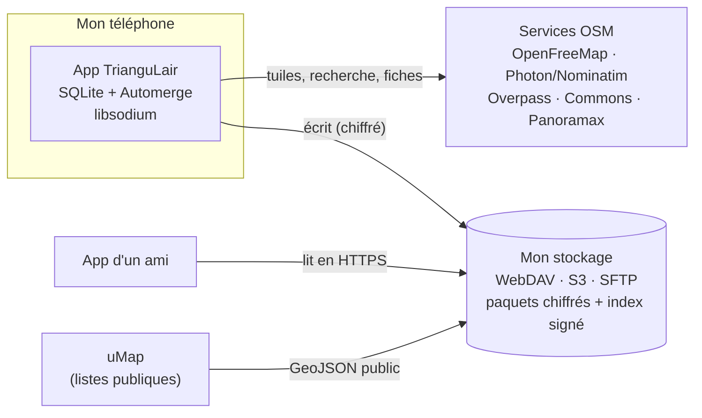

# TrianguLair — spécifications de l'app de lieux local-first et chiffrée

> Source de vérité du projet. Toute évolution passe par une pull request sur ce fichier (voir [CONTRIBUTING](../CONTRIBUTING.md)). Découpage en tâches : [TASKS.md](TASKS.md).

Version du 13 octobre 2026.

## Résumé

Nom du projet : **TrianguLair**, triple jeu de mots entre « triangulaire » et la triangulation (une bonne adresse se trouve en croisant les avis de plusieurs amis), et *lair*, le repaire en anglais (un coin privé et chiffré). Le L majuscule rend le jeu de mots visible et l'orthographe évidente. Identifiants techniques sans majuscule : `triangulair` (dépôt, domaine, identifiant de l'app).

Oui, c'est faisable, et sans serveur à maintenir : une app « mes lieux favoris » local-first, dont le contenu est stocké chiffré sur un stockage choisi par l'utilisateur (WebDAV, S3, SFTP ou simple hébergement web), et qui n'utilise que des standards ouverts (OpenStreetMap, GeoJSON, protocoles de stockage standards, chiffrement standard).

Le principe : chaque personne a une seule clé. Mon app écrit tout mon contenu, chiffré, sur mon stockage. J'envoie à un ami un lien d'invitation qui pointe vers ce contenu ; il me renvoie un lien retour avec sa clé ; je décide ce que sa clé peut ouvrir. Son app lit mon stockage directement et ne déchiffre que ce que je lui ai autorisé. Le stockage, lui, ne voit que des données illisibles.

Le prix de ce choix : pas de notifications instantanées (les ajouts des amis apparaissent à la synchronisation suivante), pas d'annuaire de comptes, et une clé à ne pas perdre. En échange : aucun serveur à exploiter, pas de modération centralisée, et une confidentialité qui ne dépend pas de l'hébergeur.

Choix arrêtés à ce stade : apps Android et iOS en React Native, local-first, stockage au choix (WebDAV, S3, SFTP, HTTPS), partage chiffré par personne avec lien d'invitation et lien retour ; épingles colorées par tag avec icône blanche cernée de gris, bandes de couleur pour les lieux à plusieurs tags ; barre de filtres repliable qui estompe les lieux hors filtre ; filtres pratiques tirés d'OpenStreetMap ; zones (quartiers, rues, dessin libre) en plus des lieux ; vérification mensuelle des lieux fermés.

## Objectifs et non-objectifs

Objectifs :

- **Aucun serveur obligatoire** : l'app fonctionne seule ; pour partager, un stockage existant suffit : WebDAV (Nextcloud, NAS), S3, SFTP ou hébergement web.
- **Chiffré de bout en bout** : le stockage ne voit jamais le contenu ; chaque personne a une seule clé, et c'est le propriétaire qui décide ce qu'elle ouvre.
- **Interopérable** : formats ouverts (GeoJSON), protocoles de stockage standards (WebDAV, S3, SFTP, HTTPS), chiffrement standard, export complet en clair à tout moment.
- **Sans dépendance à Google** : fonds de carte, recherche et données de lieux issus d'OpenStreetMap.
- **Parité avec l'usage courant des applis de lieux** : enregistrer un lieu, le tagger, le retrouver sur une carte ou en liste, partager, voir les lieux de ses amis.
- **Clients Android et iOS** : une seule base de code React Native (TypeScript), publiée sur Play Store, App Store et F-Droid, pour téléphones, pliables, tablettes et iPad, et disponible sur Mac Apple Silicon ; connectable à n'importe quel stockage compatible.
- **Pas de verrouillage** : on change de stockage quand on veut, l'app recopie tout ; export GeoJSON en clair.
- **Licence libre** : MPL-2.0, compatible avec les stores (voir Légal et publication).

Non-objectifs (au moins pour la v1) :

- Navigation GPS, itinéraires détaillés.
- Avis publics notés type Google/TripAdvisor.
- Contenu sponsorisé, guides d'influenceurs, monétisation.
- Fonctionnement hors-ligne complet de la carte du monde (seulement le cache des zones consultées).

## Architecture : local-first, stockage au choix, partage chiffré

L'app garde toutes ses données sur le téléphone, les recopie chiffrées sur un stockage choisi par l'utilisateur, et partage avec chaque ami via sa clé unique. Il n'existe aucun serveur propre au projet.

### Principe

- **Local-first** : la base de lieux vit sur le téléphone (SQLite) ; l'app marche sans réseau, sauf pour le fond de carte non mis en cache et la recherche.
- **Stockage au choix** : l'app recopie le contenu sur un stockage choisi par le propriétaire (WebDAV, S3, SFTP ou HTTPS, détail ci-dessous). Le propriétaire y a accès en lecture et écriture, depuis tous ses appareils. Sans stockage, l'app fonctionne en local seul, sans partage.
- **Tout est chiffré avant de quitter le téléphone** : le stockage, son hébergeur ou quiconque y accède ne voient que des blocs illisibles.
- **Une personne, une clé** : chaque utilisateur a une paire de clés créée sur son téléphone. La clé publique sert d'identité ; la clé privée ne quitte jamais l'appareil, sauf dans une sauvegarde chiffrée. Techniquement, une clé maîtresse issue de la phrase de récupération certifie une clé de partage, remplaçable en cas de vol sans changer d'identité (voir Perte et vol).
- **Le propriétaire décide** : pour chaque lieu, zone, commentaire ou liste, l'app emballe la clé du contenu pour la clé publique de chaque ami autorisé. Les groupes (« amis », « famille ») ne sont que des raccourcis locaux pour cocher plusieurs personnes ; personne d'autre ne les voit.
- **Les amis lisent à la source** : l'app d'un ami lit directement le stockage du propriétaire, en lecture seule, et ne déchiffre que ce qui lui est ouvert. Rien n'est envoyé ni copié chez un tiers.

### Protocoles de stockage

Le propriétaire écrit avec le protocole de son choix ; ses amis lisent toujours par une simple adresse HTTPS, incluse dans le lien d'invitation. Comme tout est chiffré, cette adresse de lecture peut être publique sans risque.

| Protocole | Écriture par le propriétaire | Lecture par les amis | Exemples |
| --- | --- | --- | --- |
| WebDAV | Oui | Lien de partage en lecture seule, ou dossier public | Nextcloud, NAS, hébergeurs |
| S3 compatible | Oui, avec une clé d'accès limitée au bucket | Adresse HTTPS publique du bucket ou d'un CDN | Scaleway, OVH, Backblaze B2, AWS, MinIO, Garage |
| SFTP | Oui, avec une clé SSH | Adresse HTTPS d'un serveur web qui sert le même dossier | Serveur perso, hébergement mutualisé |
| HTTPS seul | Non : publication par un autre moyen (export depuis l'app, Git, outil de synchronisation) | Oui | Pages statiques (Codeberg Pages, GitHub Pages), site perso |

Dans l'app, un adaptateur par protocole expose les mêmes opérations (lister, lire, écrire, supprimer, connaître la version d'un fichier) ; le reste de l'app ignore quel protocole est utilisé. Pour savoir si un fichier a changé, l'app utilise l'ETag ou la date de modification selon le protocole.

Le mode HTTPS seul convient à quelqu'un qui publie rarement (une liste de voyage, un guide) ; les trois autres permettent la synchronisation automatique et l'usage sur plusieurs appareils.

### Invitation par lien et lien retour

1. J'envoie à un ami un lien d'invitation, par n'importe quelle messagerie. Il contient l'adresse de lecture de mon contenu, ma clé publique, et une clé d'invitation temporaire (valable 7 jours) qui permet à l'invité de voir tout de suite ce que je partage avec mes amis, en attendant que j'accepte son lien retour ; elle est retirée dès l'acceptation ou à expiration.
2. Son app ouvre le lien, enregistre ma clé, puis génère un lien retour qui contient sa clé publique (et l'adresse de son propre contenu s'il partage aussi).
3. Il me renvoie ce lien ; je l'ouvre et je choisis ce qu'il peut voir (par défaut : tout ce que je partage avec « amis »).
4. Mon app ajoute les emballages pour sa clé ; il voit mon contenu à sa synchronisation suivante. Si nous partageons tous les deux, l'échange vaut dans les deux sens.

En face à face, un échange de QR codes remplace les deux liens et garantit qu'on a la bonne clé.

### Relations asymétriques

Chaque sens de la relation est indépendant :

- **Suivre quelqu'un** : mon app lit son stockage et affiche ce qu'il m'a ouvert. C'est lui qui décide, puisqu'il lui faut ma clé.
- **Être suivi** : j'ai ouvert du contenu à quelqu'un, avec sa clé.
- L'un n'implique pas l'autre. Le lien retour est donc une demande (« Paul aimerait voir tes lieux ») que le destinataire accepte, accepte partiellement ou ignore.
- Suivre une liste publique ou reçue par lien ne demande rien à personne, ni clé ni accord.
- Chaque contact affiche deux interrupteurs : « je vois ses lieux » et « il voit mes lieux ». Le mot « amis » dans l'app désigne les personnes que je suis ; les filtres et la vue Nouveautés portent sur elles.

### Partage chiffré

- Chaque élément (lieu, zone, commentaire, photo) est chiffré avec une clé aléatoire.
- Les éléments qui ont exactement les mêmes destinataires partagent une clé de lot, emballée une fois pour chaque destinataire : le contenu reste léger même avec beaucoup d'amis.
- Les emballages ne portent pas le nom du destinataire : l'app d'un ami essaie sa clé, et personne ne peut lire sur le stockage la liste de mes contacts.
- Tout est signé avec ma clé : l'app de mes amis vérifie que le contenu vient de moi et n'a pas été modifié par le stockage.
- Retirer quelqu'un : ses emballages disparaissent et les clés de lot concernées sont renouvelées ; son app ne peut plus déchiffrer ce contenu et l'efface de son cache à la synchronisation suivante ; seules échappent les copies faites volontairement (capture d'écran, export) ou une app modifiée exprès.
- Liste « avec le lien » : une clé propre à la liste, placée après le # de l'URL, partie jamais envoyée au serveur ; le lien s'ouvre dans l'app.
- Liste « publique » : publiée en clair (GeoJSON) sur le stockage, lisible par tous, y compris dans uMap.

### Organisation sur le stockage

- Un petit index signé, des paquets chiffrés (par lot de lieux ou par zone géographique) et les photos en fichiers séparés, chiffrées aussi.
- Seuls les paquets modifiés sont réécrits ; les amis demandent « est-ce que ça a changé ? » (en-tête ETag) et ne téléchargent que le nécessaire.
- Le contenu des amis est gardé en cache dans l'app (déchiffré dans la base locale, elle-même protégée par le chiffrement du téléphone) pour un affichage instantané. Il est rafraîchi à l'ouverture, régulièrement tant que l'app reste ouverte, et sur demande (tirer pour rafraîchir) , et termine juste après la fermeture de l'app ; aucune tâche périodique. En comparant l'ancienne et la nouvelle version, l'app sait exactement ce qui a changé : c'est ce qui alimente la vue Nouveautés.
- Plusieurs appareils du même utilisateur écrivent sur le même stockage ; une technique de fusion automatique (CRDT, bibliothèque Automerge) évite les conflits.
- Le stockage voit malgré tout la taille des fichiers et les dates de mise à jour ; l'app ajoute du remplissage pour limiter ce qu'on peut en déduire.

### Pas de doublons, des stockages légers

Dans l'app, un lieu n'existe qu'une fois, quel que soit le nombre d'amis qui l'ont enregistré :

- Les lieux sont identifiés par leur identifiant OpenStreetMap : si trois amis ont le même restaurant, l'app garde une seule fiche et trois enregistrements (un par personne, avec son commentaire, ses tags, son statut). Sur la carte, une seule épingle ; dans la fiche, « 3 amis ».
- Pour un point placé à la main (lieu absent d'OSM), l'app propose de fusionner quand deux points sont à moins d'une trentaine de mètres avec un nom proche ; l'utilisateur confirme.
- Les zones identiques (même quartier OSM) sont reconnues de la même façon ; les zones dessinées restent distinctes.
- « Ajouter à mes lieux » depuis un lieu d'ami crée seulement mon propre enregistrement, qui pointe vers la même fiche.

Chaque stockage ne contient que le contenu de son propriétaire :

- Rien n'est recopié chez les autres : mes amis lisent mon stockage, je lis le leur.
- Les paquets ne contiennent que les données personnelles (identifiant OSM, nom, coordonnées, tags, commentaire, statut, prix), jamais la fiche OSM (horaires, photos libres, infos pratiques), que chaque app récupère et met en cache elle-même. Ordre de grandeur : quelques centaines d'octets par lieu, soit moins de 1 Mo pour 1 000 lieux.
- Une clé de lot est emballée par groupe de destinataires identiques, pas par lieu : ajouter des amis n'alourdit presque pas le contenu.
- Photos perso facultatives, recompressées à l'envoi (environ 1 600 px de large, format WebP ou AVIF) avec une vignette séparée ; les amis ne téléchargent la photo entière qu'en l'ouvrant.
- Les zones dessinées sont simplifiées avant enregistrement.
- L'app regroupe de temps en temps les petits paquets de mises à jour et supprime les fichiers devenus inutiles ; avec Nextcloud, elle recommande de limiter l'historique des versions sur son dossier.

Côté téléphone, le cache des amis a une taille maximale réglable : leurs données restent en cache, leurs photos sont évincées en premier quand la limite est atteinte.

### Versions du format

Objectif : des amis qui n'ont pas la même version de l'app continuent de se lire, sans serveur pour coordonner.

- **Deux niveaux de version** dans l'index : mineure pour les ajouts compatibles (nouveaux champs), majeure pour les changements incompatibles.
- **Ignorer l'inconnu** : une app ignore sans erreur les champs et types d'éléments qu'elle ne connaît pas, et les conserve tels quels quand elle réécrit son propre contenu (cas de deux appareils d'un même utilisateur avec des versions différentes).
- **Chacun annonce ce qu'il sait lire** : l'index publie la liste des versions que l'app de son propriétaire comprend. En écrivant, l'app choisit pour chaque lot la version la plus récente que tous ses destinataires savent lire. Pas besoin de serveur : l'information est déjà dans les index que chacun lit.
- **Transition douce** : lors d'une version majeure, l'app écrit dans l'ancien et le nouveau format tant qu'un ami n'a pas mis à jour, dans la limite d'un an.
- **Message clair** quand un contenu reste illisible : « Mets à jour l'app pour voir les lieux de Léa ».
- **Algorithmes identifiés** dans chaque lot (chiffrement, emballage, signature) : on peut en changer plus tard, par exemple vers un chiffrement résistant aux ordinateurs quantiques, sans casser les anciens contenus.
- **Lecture garantie** des anciens formats pendant au moins deux ans après leur remplacement.
- **Spécification publique** du format, versionnée, avec vecteurs de test, et tests automatiques de lecture croisée entre les dernières versions de l'app.

### Ce qu'on accepte de perdre

| Sans serveur | Conséquence | Parade |
| --- | --- | --- |
| Pas de notifications instantanées | Les ajouts des amis apparaissent à la synchronisation suivante | Synchro à l'ouverture et sur demande |
| Pas d'annuaire | On ne trouve personne par pseudo | Liens d'invitation, QR codes |
| Clé privée sur le téléphone | Perdre la clé, c'est perdre l'accès | Phrase de récupération et sauvegarde chiffrée sur le stockage |
| Un stockage est nécessaire pour partager | Il faut un stockage (WebDAV, S3, SFTP) | Nextcloud et S3 sont proposés par de nombreux hébergeurs ; local seul possible sans partage |
| Lecture par lien de partage | L'ami doit pouvoir lire le dossier | Lien de partage en lecture seule, ou dossier public : sans danger puisque tout est chiffré |

## Standards et formats interopérables

Toutes les briques utilisent un standard existant ; le seul format propre au projet est l'organisation des paquets chiffrés, documentée et ouverte.

| Besoin | Standard retenu | Remarque |
| --- | --- | --- |
| Stockage | WebDAV (RFC 4918), API S3, SFTP, HTTPS en lecture | Un adaptateur par protocole ; les amis lisent toujours en HTTPS |
| Chiffrement des contenus | XChaCha20-Poly1305 (libsodium) | Bibliothèque éprouvée, disponible en TypeScript |
| Emballage des clés | X25519 (boîtes scellées libsodium), structure inspirée de JWE (RFC 7516) | Une clé publique par personne |
| Signature | Ed25519 | Authenticité du contenu |
| Synchronisation multi-appareils | CRDT (Automerge) | Fusion automatique des modifications |
| Liens de partage | URL avec clé dans le fragment (#) | Le fragment n'est jamais envoyé au serveur |
| Données des lieux | OpenStreetMap (licence ODbL) | Nom, catégorie, horaires, cuisine, régimes, terrasse, réservation, prix d'entrée, site, téléphone ; photos libres via Wikimedia Commons et Panoramax ; limites de quartiers et tracés de rues pour les zones |
| Identifiants de lieux | OpenStreetMap (node/123, way/456) | Nom et coordonnées copiés localement |
| Fonds de carte | Vector tiles (MVT), PMTiles, style MapLibre | Un seul fichier, hébergeable en statique |
| Recherche d'adresses | API Nominatim / Photon | Services publics ou auto-hébergés |
| Export / import | GeoJSON (principal), GPX, KML, CSV | Ouvrables dans uMap, QGIS, Google My Maps, Organic Maps |
| Import depuis Google | Google Takeout « Saved places » (GeoJSON) | Pour migrer ses favoris |
| Import depuis Mapstr | Export CSV de Mapstr | Colonnes à vérifier sur un vrai export |

Une limite connue : les identifiants OpenStreetMap ne sont pas parfaitement stables (un objet peut être supprimé ou recréé). Chaque lieu enregistré garde donc aussi ses coordonnées et son nom en copie locale, l'ID OSM n'étant qu'un lien d'enrichissement.

## Fonctionnalités

Le MVP couvre l'usage solo et le partage entre amis via stockage WebDAV et chiffrement par personne.

### MVP (v1)

- [ ] Création de l'identité (paire de clés sur le téléphone, phrase de récupération), profil (nom, avatar) ; connexion facultative à un stockage WebDAV
- [ ] Carte plein écran avec ses lieux et zones, regroupés au dézoom
- [ ] Vue liste avec tri (récent, distance, nom) et recherche texte
- [ ] **Ajouter un lieu** : l'écran d'ajout affiche d'emblée les lieux connus autour de la zone visible (ou de ma position), triés par distance croissante ; puis recherche par nom (Photon/Nominatim), appui long sur la carte, ou position actuelle
  - [ ] Chaque lieu proposé indique s'il est déjà dans mes lieux ou enregistré par des amis
- [ ] **Ajouter une zone** : quartier existant, un ou plusieurs bouts de rue, ou dessin libre (par points ou par peinture au doigt) — détail ci-dessous
- [ ] Fiche lieu enrichie automatiquement : infos pratiques, photos libres et horaires d'ouverture quand ils existent (détail ci-dessous)
- [ ] Tags personnels avec couleur et icône, sous-tags possibles (« Resto › Pizza napolitaine »)
- [ ] **Barre de filtres** sur la carte et la liste : catégories, sous-filtres de la catégorie (types de cuisine, de musée, de boutique), critères pratiques issus d'OSM (ouvert maintenant, happy hour, terrasse, régime, réservation, entrée gratuite, prix d'entrée), statut, visibilité, niveau de prix, recherche texte ; repliable en une ligne de résumé, état mémorisé
- [ ] Affichage filtré : les épingles qui correspondent restent en couleur, les autres sont grisées, estompées et plus petites
- [ ] Commentaire avec sa propre visibilité : privé, amis ou public (amis par défaut ; « public » le rend visible dans les listes publiques) ; statut « à tester / testé / favori », niveau de prix (€ à €€€€), photos perso
- [ ] **Partage d'un lieu** : partagé avec les amis par défaut ; la section Partage de la fiche permet de le passer en privé, ou de l'ajouter à une ou plusieurs listes de partage ; un lieu privé n'apparaît jamais chez les autres, ni dans les compteurs « amis », ni dans aucune liste
- [ ] Suivre et partager, de façon indépendante dans chaque sens : lien d'invitation, demande par lien retour, QR code en face à face, ou simple abonnement à une liste publique ou par lien
- [ ] **Lieux des amis** : filtre « Aussi chez mes amis » / « Lieux de mes amis », avec choix des amis affichés (tous, aucun ou une sélection mémorisée) ; mention « 3 amis » dans la liste, la fiche et l'écran d'ajout (pas sur l'épingle), qui ouvre qui l'a enregistré, quand, et leurs commentaires, dans la limite de ce que chacun a rendu visible ; vue Nouveautés qui liste ce qui a changé chez les amis depuis la dernière consultation
- [ ] **Listes** : sous-ensembles à partager, définies par un filtre enregistré, qui se met à jour seul, ou par une sélection manuelle (détail ci-dessous)
- [ ] **Visibilité des listes de partage** : réglée dans la liste elle-même : publique (visible de tous) ou accessible seulement avec le lien ; une liste n'affiche jamais un lieu privé
- [ ] **Lieux fermés** : vérification automatique mensuelle et signalement (détail ci-dessous)
- [ ] Partage d'un lieu, d'une zone ou d'une liste par lien web (consultable sans compte pour une liste publique ou par lien)
- [ ] Ouvrir l'itinéraire dans l'app de navigation du téléphone, et ouvrir le lieu dans Plans ou Google Maps pour consulter avis et photos
- [ ] Import depuis Google Maps, Mapstr, Pin Drop et autres (Takeout, CSV, KML, GeoJSON) ; export GeoJSON complet
- [ ] Apps Android et iOS (React Native) + lien « Voir sur uMap » pour les listes publiques

### Créer une liste de partage

Une liste combine des critères ; tout nouveau lieu qui les remplit y entre automatiquement.

- **Catégories et tags** : un ou plusieurs (Resto, Bar, « brunch »…), avec les sous-filtres et statuts habituels (testé, favori…).
- **Zones, par nom** : chercher une ville, une région ou un pays ; les limites viennent d'OpenStreetMap (limites administratives), plusieurs zones possibles (« Lyon » + « Portugal »).
- **Zones, par détourage** : dézoomer et entourer une partie de la carte au doigt, avec les mêmes outils que pour dessiner une zone (par points ou par peinture).
- **Exceptions** : retirer ou ajouter un lieu à la main, sans casser le filtre.
- **Aperçu** : carte des zones choisies, lieux retenus en couleur et autres estompés, et nombre de lieux avant de valider.
- **Partage** : avec le lien ou publique, comme pour toute liste.

Technique : une zone par nom est enregistrée comme identifiant OSM (relation de limite administrative) plus une forme simplifiée, pour rester légère même pour un pays ; une zone détourée est un polygone simplifié. Le filtre de la liste est stocké en JSON (tags, catégories, statuts, zones, exceptions).

### Suivre une liste sans suivre la personne

Une liste publique ou reçue par lien se suit sans compte, sans demande et sans clé personnelle : le lien suffit.

Ouvrir un lien de liste :

- **App installée** : aperçu (carte et liste des lieux, nom de l'auteur, date de mise à jour), puis trois actions : « Suivre cette liste », « Ajouter des lieux à mes lieux » (un par un ou tous), « Demander à suivre l'auteur » (envoie une demande par lien retour).
- **App non installée** : une liste publique s'affiche dans uMap ; une liste par lien renvoie vers la page du store.

Une fois suivie :

- La liste apparaît dans un panneau « Listes suivies », chacune avec un interrupteur pour l'afficher sur la carte.
- Ses lieux s'affichent avec le même style que les lieux des amis, et répondent aux mêmes filtres ; un filtre « Source » permet de choisir mes lieux, mes amis, ou telle liste.
- Les ajouts et modifications de la liste apparaissent dans les Nouveautés.
- Les lieux déjà présents chez moi ou chez mes amis ne sont pas doublés : même fiche, avec la mention de la liste.

Côté auteur :

- Il ne sait pas qui suit sa liste : la lecture se fait directement sur son stockage, sans inscription.
- Pour couper l'accès à une liste « avec le lien », il en génère un nouveau ; l'ancien cesse de fonctionner et les abonnés voient « Ce lien ne fonctionne plus ».

Technique : la liste porte la clé publique de son auteur et sa signature, ce qui permet de vérifier qu'elle n'a pas été modifiée, et de la rattacher automatiquement à l'auteur si on le suit plus tard. L'app garde, pour chaque liste suivie, son adresse, la clé du lien, la clé de l'auteur et la dernière version lue. Limite : l'hébergeur du stockage de l'auteur voit l'adresse IP de ceux qui lisent la liste, comme pour n'importe quelle page web.

### Consulter sans l'app

En v1, aucune page web maison :

- **Liste publique** : déjà publiée en GeoJSON en clair sur le stockage de l'auteur ; l'app propose un lien « Voir sur uMap », qui ouvre la liste sur une carte web uMap (instance publique d'OpenStreetMap France ou autre instance). uMap lit les données distantes en passant au besoin par son serveur, ce qui évite les questions de CORS, et se met à jour quand le fichier change. Les couleurs de l'auteur sont incluses dans le GeoJSON sous une forme que uMap sait lire, au moins en partie.
- **Liste « avec le lien »** : chiffrée, donc illisible pour uMap ; le lien ouvre l'app si elle est installée, sinon la page du store.
- Limites acceptées : rendu propre à uMap (pas nos épingles ni nos filtres) ; le serveur de uMap voit les données, ce qui ne pose pas de problème pour une liste publique.

En v2, si le partage chiffré hors app manque : page web maison, statique, qui déchiffre dans le navigateur (clé dans le fragment de l'URL), avec carte, liste, fiches et appels à installer l'app ; hébergée sur le stockage de l'auteur quand il sait servir des pages web, ou sur un hébergement statique du projet (lecture CORS à vérifier, notamment pour Nextcloud).

### Modifier et supprimer

Modifier :

- Tout se modifie depuis la fiche (tags, commentaire, statut, prix, photos, partage, géométrie d'une zone) ; la modification part à la synchronisation suivante.
- Chez les amis, seules les modifications qui ont du sens apparaissent dans les Nouveautés (nouveau commentaire, passage à « testé » ou « favori », nouvelle photo), pas les retouches mineures (couleur d'un tag, correction d'une faute).
- Deux appareils qui modifient le même lieu sont fusionnés automatiquement (CRDT) ; si l'un supprime pendant que l'autre modifie, la suppression l'emporte, et le lieu reste récupérable dans la corbeille.

Supprimer :

| Action | Chez moi | Chez mes amis |
| --- | --- | --- |
| Supprimer un lieu, une zone ou un commentaire | Corbeille pendant 30 jours, synchronisée entre mes appareils et restaurable | Disparaît de leur cache à la synchronisation suivante |
| Retirer l'accès d'un ami à un lieu ou une liste | Rien ne change | Disparaît de son cache à sa synchronisation suivante |
| Supprimer une liste | Les lieux restent, seule la liste disparaît | Le lien affiche « Cette liste n'existe plus » |
| Retirer un ami | Ses lieux disparaissent de mon cache, il perd tous ses accès | Il ne voit plus mes mises à jour |
| Supprimer tout mon contenu | Effacement local et de tous les fichiers sur le stockage | Leurs apps effacent mon contenu de leur cache |

Mécanique :

- Une suppression laisse un marqueur signé (identifiant et date) dans un paquet ; les apps des amis effacent l'élément correspondant de leur cache.
- Filet de sécurité : l'index liste tous les éléments existants ; une app qui revient après une longue absence efface de son cache tout ce qui n'y figure plus, même si les marqueurs ont été purgés entre-temps (ils sont conservés six mois).
- Supprimer tout son contenu : l'app efface les fichiers du stockage, mais laisse pendant quelques mois un marqueur signé « contenu supprimé » pour que les apps des amis vident leur cache, puis le retire. Le kit de récupération devient alors inutile, ce que l'app indique.
- Si j'ai ajouté à mes lieux un lieu vu chez un ami, mon enregistrement est indépendant : il reste si l'ami supprime le sien.
- Rappel discret au moment de retirer un accès : le contenu disparaît de l'app de l'ami à sa synchronisation suivante, mais une copie faite volontairement (capture d'écran) ne peut pas être reprise.

### Importer ses lieux

L'import sert d'abord à faire venir les utilisateurs de Mapstr, Pin Drop ou Google Maps sans ressaisie ; il fait donc partie du MVP.

| Source | Format | État |
| --- | --- | --- |
| Google Maps | Google Takeout (GeoJSON, CSV) | Format connu |
| Mapstr | Export CSV, mentionné dans la fiche App Store de Mapstr | Colonnes et éventuelle restriction à l'offre payante à vérifier sur un vrai compte |
| Pin Drop et apps similaires | KML ou CSV selon l'app | Export de Pin Drop à vérifier |
| Autres apps, tableurs | CSV générique, avec assistant de correspondance des colonnes (nom, coordonnées ou adresse, note, tags) | — |
| Cette app | GeoJSON | Format connu |

Traitement :

- Chaque lieu importé est rapproché d'un lieu OpenStreetMap par son nom et sa position, ou par son adresse. Les correspondances sûres sont automatiques ; les douteuses sont présentées pour validation, sur la carte ; sans correspondance, le lieu devient un point placé à la main.
- Les tags de la source deviennent mes tags, avec leurs couleurs si l'export les contient ; les notes deviennent des commentaires ; les statuts connus (testé, à tester) sont repris.
- Pas de doublons : réimporter un fichier ou importer depuis deux sources fusionne les lieux identiques.
- Résumé final : nombre de lieux importés, rattachés à OSM, à vérifier, ignorés ; import annulable en un geste pendant quelques jours.

### Détection des lieux fermés

Une tâche de fond revérifie chaque lieu enregistré une fois par mois, et aussi quand on ouvre sa fiche si la dernière vérification date de plus d'un mois, et le marque « peut-être fermé » au premier signal ; c'est l'utilisateur qui confirme, rien n'est supprimé automatiquement.

Signaux détectés :

| Source | Signal | Fiabilité |
| --- | --- | --- |
| OpenStreetMap | Objet supprimé de la base | Forte |
| OpenStreetMap | Étiquette passée en préfixe de cycle de vie : `disused:shop`, `was:amenity`, `abandoned:` | Forte |
| OpenStreetMap | Nom ou catégorie changé au même endroit (nouveau commerce) | Moyenne |
| OpenStreetMap | Horaires retirés ou passés à `off` | Faible |
| Utilisateurs | Toi ou un ami signalez « fermé » | Moyenne, forte à partir de 2 signalements |
| Amis | Signalement « fermé » d'un ami, lu dans son contenu partagé | Moyenne |

Ce qui se passe ensuite :

1. Le lieu prend un badge « peut-être fermé » sur la carte et dans la liste, avec la raison et la date du signal.
2. À l'ouverture de l'app, un encart groupé (au plus une fois par mois) liste les lieux concernés.
3. L'utilisateur confirme « fermé », « toujours ouvert » ou « a déménagé » (avec nouvelle adresse).
4. Un lieu fermé reste dans l'historique avec ses commentaires, masqué par défaut via le filtre statut ; il sort des listes publiques.
5. Si l'information vient d'un utilisateur et pas d'OSM, l'app propose de la corriger dans OpenStreetMap, ce qui profite à tous.

Côté technique : c'est l'app qui interroge l'API Overpass, par petits lots d'identifiants à l'ouverture de l'app, au plus une fois par mois par lieu ; une charge très légère pour les services OSM.

### Fiche lieu : infos, photos, horaires

À l'ajout d'un lieu, l'app récupère tout ce qui existe dans des sources libres et le met en cache ; les champs vides restent simplement masqués.

| Donnée | Source | Remarque |
| --- | --- | --- |
| Catégorie, cuisine, adresse | OpenStreetMap | Détermine l'icône par défaut |
| Téléphone, site web, e-mail, réseaux sociaux | OpenStreetMap | Boutons d'action directs (appeler, ouvrir le site) |
| Horaires d'ouverture | OpenStreetMap (`opening_hours`) | Interprétés avec la bibliothèque opening\_hours.js : « Ouvert, ferme à 22 h », jours fériés, et filtre « ouvert maintenant » |
| Accessibilité, terrasse, Wi-Fi, végétarien | OpenStreetMap | Affichés en pictogrammes |
| Photos du lieu | Wikimedia Commons et Wikidata (liens `image`, `wikimedia_commons`, `wikidata` dans OSM) | Photos libres, avec crédit de l'auteur affiché |
| Photos de rue | Panoramax (libre), Mapillary en option | Vue de la façade quand aucune photo n'existe |
| Photos des utilisateurs | Toi et tes amis | Visibles selon la visibilité du lieu |
| Description | Wikipédia via Wikidata, si l'article existe | Surtout pour monuments et musées |

Pas de récupération des photos de Google ou des sites des établissements : elles sont protégées par le droit d'auteur. Les horaires et infos sont rafraîchis en même temps que la vérification mensuelle des fermetures.

### Filtres issus des données sources

Les filtres pratiques s'appuient sur des champs OpenStreetMap ; chaque catégorie de lieu a son propre jeu de filtres.

| Catégorie | Filtre | Champ OSM | Affichage |
| --- | --- | --- | --- |
| Toutes | Ouvert maintenant / ouvert à une heure choisie | `opening_hours` | « Ouvert, ferme à 22 h » ; jours fériés gérés |
| Restos, bars, cafés | Happy hour en cours | `happy_hours` | « Happy hour jusqu'à 20 h » |
| Restos, bars, cafés | Terrasse | `outdoor_seating=yes` | Oui / non / inconnu |
| Restos | Type de cuisine | `cuisine` (plusieurs valeurs possibles) | Sous-filtres : burger, italien, chinois, indien, régional… |
| Restos, commerces | Régime | `diet:vegetarian`, `diet:vegan`, `diet:gluten_free`, `diet:halal`, `diet:kosher` | « Options » ou « exclusivement » selon la valeur (yes / only) |
| Restos | Réservation | `reservation` | Recommandée, obligatoire, possible, non |
| Musées, monuments, sites | Ouvert maintenant | `opening_hours` | Comme ci-dessus |
| Musées, monuments, sites | Entrée gratuite / payante | `fee` | Gratuit / payant / inconnu |
| Musées, monuments, sites | Prix d'entrée | `charge` (ex. « 12 EUR ») | Montant affiché dans la fiche, filtre « moins de X € » quand il est renseigné |
| Musées | Type de musée | `museum` (art, histoire, sciences…) | Sous-filtres |
| Boutiques | Ouvert maintenant | `opening_hours` | Comme ci-dessus |
| Boutiques | Type de boutique | `shop` (librairie, vêtements, fromager…) | Sous-filtres |
| Boutiques | Seconde main, bio | `second_hand`, `organic` | Oui / non / inconnu |

Niveau de prix des restos et bars : absent d'OSM (une proposition de tag a été abandonnée), donc saisi par l'utilisateur de € à €€€€, avec la moyenne des amis quand ils l'ont renseigné.

Règles communes :

- Un filtre n'apparaît que si assez de lieux affichés ont l'information, avec leur nombre.
- Un lieu sans l'information n'est pas exclu en silence : il apparaît dans un groupe « info inconnue », estompé comme les lieux hors filtre.
- La fiche propose de compléter une information manquante, et de la contribuer à OpenStreetMap si l'utilisateur le souhaite.

### Zones : quartiers, bouts de rue

On peut enregistrer une zone au lieu d'un point : elle a les mêmes tags, notes, photos, visibilité et filtres qu'un lieu, et s'affiche comme un aplat ou un trait à la couleur de son tag, avec un badge en son centre.

Trois façons d'en créer une :

| Mode | Geste | Géométrie | Source |
| --- | --- | --- | --- |
| Quartier existant | Toucher un quartier sur la carte ou le chercher par nom | Polygone | Limites OSM (`place=neighbourhood`, `quarter`, `suburb`), copiées localement |
| Bout de rue | Toucher une rue, puis glisser deux poignées pour choisir le début et la fin ; « Ajouter un tronçon » pour en enchaîner d'autres, contigus (le tracé suit les rues à travers les carrefours) ou séparés | Une ou plusieurs lignes qui suivent les rues | Tracé de la rue dans OSM, découpé entre les deux points |
| Dessin libre | Deux variantes. Par points : poser les sommets un à un, toucher le premier point pour fermer, puis déplacer ou ajouter des points. Par peinture : ombrer la zone au doigt comme au feutre (épaisseur réglable, gomme), l'app en déduit une forme lissée | Polygone | Saisie de l'utilisateur ; la variante peinte est marquée « contour flou » |

Affichage :

- Zone : aplat transparent (environ 20 %) avec contour de 2,5 px à la couleur du tag principal. Zone peinte (contour flou) : pas de contour, mais un bord dégradé en trois anneaux d'opacité décroissante, pour signaler une limite approximative.
- Bout de rue : trait épais transparent le long de la rue, avec un trait fin plein au centre.
- Icône de zone : un badge carré aux coins arrondis (même taille, couleurs, icône, liseré et bandes multi-tags que les épingles), mais sans pointe, pour signaler une surface et pas un point précis. Il est placé au point le plus central à l'intérieur de la forme (même pour une forme en L ou en croissant), et au milieu du plus long tronçon pour une rue. Au dézoom, il ne reste que le badge.
- Hors filtre, la zone s'estompe comme les épingles.
- La fiche d'une zone liste aussi les lieux enregistrés à l'intérieur (les siens et ceux des amis visibles).
- Pas d'horaires ni de détection de fermeture pour une zone.

Technique : la base locale (SQLite avec extension spatiale) accepte point, ligne ou polygone, avec un indicateur edge (net / flou). Une zone peinte est calculée sur le téléphone : chaque trait est élargi à son épaisseur, les traits sont fusionnés, puis la forme est lissée et simplifiée (bibliothèque Turf.js) ; seule la forme finale est enregistrée. À l'export comme dans les paquets partagés, la zone est un objet GeoJSON Polygon, LineString ou MultiLineString (plusieurs tronçons).

### v2 — partage avancé

- [ ] Listes collaboratives à plusieurs auteurs (chacun écrit sur son propre stockage, l'app fusionne)
- [ ] Autres stockages : Remote Storage, publication automatique via Git
- [ ] Migration d'un stockage à un autre en un geste
- [ ] Historique des accès accordés et renouvellement automatique des clés
- [ ] Page web maison pour consulter sans l'app, y compris les listes chiffrées par lien

### v3 et plus — confort

- [ ] Cartes hors-ligne : téléchargement d'une région en PMTiles
- [ ] Lieux suggérés : lieux de ses amis près de soi
- [ ] Widget « lieux les plus proches »
- [ ] Réactions (« j'aime ») sur les lieux des amis
- [ ] Partage depuis Google Maps vers l'app (intent Android, share extension iOS)
- [ ] Contribution facilitée vers OpenStreetMap (signaler un horaire faux)

## Fonctionnalités des applis de lieux existantes : ce qu'on porte

Sur 25 fonctionnalités recensées dans les applis de lieux existantes, 13 sont reprises dès la v1, 1 en v2, 5 plus tard, et 6 écartées car elles reposent sur des partenariats commerciaux, la monétisation ou une IA propriétaire, ou n'apportent rien à l'usage visé. La colonne Décision est modifiable.

| Fonctionnalité | Décision | Chez nous |
| --- | --- | --- |
| Enregistrer un lieu : recherche, autour de moi, point sur la carte | Oui, v1 | Avec la liste des lieux proches triés par distance |
| Tags personnalisés et colorés, filtre par tag | Oui, v1 | Étendu à des filtres combinables |
| Commentaires personnels sur un lieu | Oui, v1 | Visibilité au choix pour chaque commentaire : privé, amis ou public |
| Photos personnelles | Oui, v1 | Métadonnées GPS supprimées à l'envoi |
| Fiche pratique : adresse, horaires, téléphone, site, photos | Oui, v1 | Via OpenStreetMap ; moins de photos |
| Voir les adresses et commentaires des amis | Oui, v1 | Filtre « aussi chez mes amis », choix des amis affichés, détail et commentaires dans la fiche |
| Carte privée ou publique, partage sélectif | Oui, v1 | Plus fin : visibilité par lieu et par liste |
| Partage par lien, même à des amis sans l'app | Oui, v1 | Listes publiques visibles dans uMap ; listes par lien dans l'app |
| Itinéraire via Google Maps, Citymapper, Uber | Oui, v1 | Ouverture de l'app de navigation choisie |
| Import depuis Google Maps, Foursquare | Oui, v1 | Google Takeout en v1, autres formats ensuite |
| Version web | Oui, v1 | Listes publiques via uMap en v1 ; page maison en v2 |
| Suivre des amis | Oui, v1 | Par lien d'invitation et lien retour, ou QR code |
| Préparer un voyage | Oui, v1 | Couvert par les listes filtrées par zone |
| Cartes officielles de magazines et influenceurs | Oui, v2 | Tout utilisateur peut publier une liste publique, consultable sur le web ; pas de partenariats |
| Scanner une adresse en photo (OCR) | Plus tard | Utile mais secondaire |
| Carte collaborative à plusieurs | Plus tard | Listes collaboratives |
| Alertes de proximité | Non | Écartées : inutiles pour l'usage visé, et elles demanderaient une activité en arrière-plan |
| Widget « lieux les plus proches » | Plus tard | Android et iOS |
| Usage hors connexion | Plus tard | Lieux toujours disponibles hors ligne dès la v1 (local-first) ; cartes hors ligne par région plus tard |
| Import depuis Instagram et TikTok | Plus tard | Via le menu de partage du téléphone vers l'app |
| Suggestions personnalisées par IA | Non | Remplacé par « lieux de mes amis autour de moi » |
| Réservation de table en un clic | Non | Repose sur des partenariats commerciaux |
| Cartes payantes à acheter | Non | Hors du modèle libre |
| Limite de lieux en gratuit, abonnement payant | Non | Illimité ; seule limite, la place sur ton stockage |
| Offre payante pour restaurants, hôtels, marques | Non | Hors périmètre |

Ce que le projet ajoute : stockage chez soi, chiffrement de bout en bout, export complet en GeoJSON, filtres combinables issus d'OpenStreetMap (ouvert maintenant, terrasse, régime, prix d'entrée…), listes définies par un filtre qui se mettent à jour seules, zones (quartiers, bouts de rue, dessin libre), détection des lieux fermés.


## Interface

L'interface reprend les codes visuels qui font la lisibilité des applis de lieux : des épingles colorées par tag avec une icône par catégorie, une barre de filtres claire, et une fiche lieu qui monte du bas de l'écran. Les icônes et le design restent originaux : on s'inspire des principes, pas des fichiers ni de l'identité graphique d'une autre appli.

Épingles sur la carte :

- **Forme** : pastille ronde avec pointe, couleur pleine = couleur du tag principal du lieu, icône blanche cernée de gris foncé au centre ; liseré blanc de 2,5 px plus un contour sombre de 1 px, pour rester visible sur tous les fonds (ville, parc, eau, mode sombre).
- **Icône** : celle choisie pour le tag ; à défaut, celle de la catégorie OSM (restaurant, café, bar, musée, boutique…).
- **Taille** : environ 34 px de base, 40 px pour le lieu sélectionné, 24 px au dézoom ; icône à environ 60 % du diamètre (21 px à taille normale), au tracé épaissi pour la lisibilité ; zone tactile d'au moins 44 px dans tous les cas.
- **Lieux des amis** : aucun badge sur les épingles ; un filtre « Aussi chez mes amis » (ou « Lieux de mes amis ») les met en évidence, et le détail (qui, quand, commentaires) est dans la fiche.
- **Statuts** : « peut-être fermé » signalé par une petite croix grise ; les autres statuts passent par les filtres, pas par l'apparence de l'épingle.
- **Regroupement** : au dézoom, une bulle avec le nombre de lieux, dans la couleur du tag majoritaire.

Couleurs et catégories :

- Palette vive de 17 couleurs prédéfinies : rouge #EF4444, rose #EC4899, fuchsia #C026D3, violet #8B5CF6, indigo #6366F1, bleu #3B82F6, ciel #0284C7, cyan #0891B2, turquoise #0D9488, vert #16A34A, citron #65A30D, jaune #FACC15, ambre #D97706, orange #EA580C, terre #A16207, ardoise #475569, encre #1E293B. L'icône est toujours blanche, cernée d'un contour gris foncé (#1F2937) d'environ 1 px sur toutes les couleurs, ce qui la rend lisible même sur le jaune et garde un rendu homogène. Ce contour est dessiné dans les fichiers d'icônes eux-mêmes, pas ajouté par un effet. Toute couleur libre est donc possible, y compris très claire.
- Bibliothèque d'environ 150 icônes sous licence libre, regroupées par catégorie (manger, boire, sortir, culture, nature, shopping, services, voyage) : base Maki et Temaki (CC0), complétée au besoin.
- Chaque nouveau tag reçoit une couleur et une icône suggérées selon son nom (« sushi » → icône sushi), modifiables.
- Un lieu peut avoir plusieurs tags : la moitié haute de l'épingle, où se trouve l'icône, prend la couleur et l'icône du tag principal ; la moitié basse, vers la pointe, est découpée en bandes horizontales égales aux couleurs des autres tags (3 bandes maximum, donc 4 tags affichés ; au-delà, un petit « +N » à côté de l'épingle). Au dézoom (24 px), l'épingle repasse à la seule couleur du tag principal. Quand un filtre est actif, l'épingle prend la couleur et l'icône du tag filtré. Filtres actifs : les épingles qui correspondent restent en couleur, les autres passent en gris, à environ 35 % d'opacité et en plus petit (28 px), pour garder le contexte sans gêner la lecture ; sans filtre, toutes sont en couleur. Dans la fiche, tous les tags sont affichés en pastilles ; les réordonner change le tag principal.

Tags des autres : sur ma carte, mon vocabulaire et mes couleurs s'appliquent toujours ; les tags des personnes suivies s'y raccrochent ainsi :

- **Par la catégorie commune** : chacun de mes tags peut être relié à des catégories OSM (« Resto » ↔ restaurant, fast-food) ; un lieu d'ami de cette catégorie prend ma couleur et mon icône, quel que soit le nom de son tag.
- **Par le nom** : rapprochement automatique des tags équivalents (majuscules, accents, pluriels, synonymes courants comme « resto » et « restaurant »).
- **Par correspondance manuelle** : « le "Bouffe" de Léa = mon "Resto" », mémorisée et réutilisée pour tous ses lieux.
- **Sans correspondance** : le tag garde la couleur et l'icône choisies par son auteur, tant que je ne les change pas pour moi ; il apparaît dans une section « Tags de mes amis » du panneau de filtres (avec sa couleur et le nom de l'auteur), où je peux le filtrer, le recolorer pour moi, le relier à un de mes tags, ou l'adopter en un tap. Si sa couleur est identique à celle d'un de mes tags, l'app le signale dans ce panneau pour éviter la confusion.
- **Filtres** : filtrer sur un de mes tags inclut les lieux des amis qui ont un tag correspondant ou la bonne catégorie.
- **Listes suivies** : option pour afficher une liste avec les couleurs de son auteur, quand sa mise en forme fait partie du contenu (guide, recommandations de voyage).
- **Ajout à mes lieux** depuis un lieu d'ami : tags pré-remplis grâce aux correspondances.

Écrans principaux :

- **Carte** plein écran, barre de recherche et barre de filtres en haut, bouton « + » pour ajouter. La barre de filtres montre les catégories, puis les sous-filtres de la catégorie choisie (types de cuisine présents dans tes lieux, issus d'OSM ou de tes sous-tags, avec leur nombre), puis les critères pratiques (aussi chez mes amis, végétarien, ouvert maintenant), le nombre de lieux correspondants et un bouton « Effacer les filtres ». La barre se replie en une seule ligne de résumé (une pastille par filtre actif, avec une croix pour le retirer, et un bouton « Filtres (3) » pour redéplier) ; elle se replie d'elle-même quand on fait défiler la carte, et l'état choisi est mémorisé. Le filtre amis ouvre un panneau de choix : « Tous mes amis », « Aucun » ou une sélection, avec recherche, avatar et nombre de lieux par ami ; la sélection est mémorisée.
- **Gestion des tags** : chaque tag avec sa couleur, son icône, son nombre de lieux, ses catégories OSM reliées et ses correspondances avec les tags des amis.
- **Fiche lieu** en panneau glissant du bas : photo, nom, statut d'ouverture, tags colorés, ta note, puis les amis qui l'ont enregistré et leurs commentaires.
- **Liste** : mêmes pastilles colorées en début de ligne, distance à droite.
- **Nouveautés** : activité des amis depuis la dernière consultation (lieux ajoutés, commentaires, listes partagées avec moi, fermetures signalées), groupée par jour, filtrable par type et par ami ; les éléments non vus sont marqués d'un point. Un bouton « Voir sur la carte » active le filtre « nouveautés » (les autres lieux sont estompés). Badge sur l'onglet ; pas de notification, les nouveautés apparaissent à l'ouverture de l'app.

À produire en phase 0 : maquettes de ces quatre écrans et planche des icônes et couleurs, à valider avant développement.

## Premier lancement

Principe : arriver sur la carte en moins d'une minute. La clé est créée sans rien demander, la sauvegarde est proposée quand il y a quelque chose à perdre, et le stockage seulement quand on veut partager.

### Trois entrées

| Entrée | Quand | Ce qui se passe |
| --- | --- | --- |
| **Commencer** | Nouvel utilisateur | Parcours standard ci-dessous |
| **J'ai reçu une invitation** | L'app est ouverte depuis le lien d'un ami (ou le lien est collé après installation) | « Marie partage ses lieux avec toi », puis prénom ; ses lieux partagés avec ses amis s'affichent tout de suite grâce à la clé d'invitation temporaire, sans configurer de stockage ; l'app prépare le lien retour à lui renvoyer |
| **J'ai déjà mes lieux** | Nouvel appareil ou réinstallation | Ajout depuis un autre appareil par QR code, ou restauration avec la phrase de récupération et l'adresse du stockage |

### Parcours standard

1. **Bienvenue** : un écran, la promesse en une phrase (« Tes lieux, chez toi, chiffrés »), bouton « Commencer ».
2. **Prénom et photo** (facultative) : ce que tes amis verront. La paire de clés est créée en arrière-plan pendant ce temps, sans écran dédié.
3. **Localisation** (facultative) : expliquée avant la demande du système (« pour centrer la carte, jamais envoyée »).
4. **Importer ?** : Google Takeout, Mapstr, GeoJSON, ou « Plus tard ».
5. **La carte**, avec une bulle d'aide sur le bouton « + » pour ajouter un premier lieu.

### Plus tard, au bon moment

- **Sauvegarde** : après une dizaine de lieux ou quelques jours, une carte « Protège tes lieux » propose de connecter un stockage (sauvegarde chiffrée automatique), et enregistrer son kit de récupération (phrase de 12 mots, vérifiée en redemandant 3 mots, et adresse du stockage) dans un gestionnaire de mots de passe ou sur papier (détail ci-dessous). Rappel discret tant que rien n'est fait.
- **Stockage** : proposé la première fois qu'on veut partager (inviter un ami, créer une liste par lien ou publique). Assistant par protocole :
  - Nextcloud : connexion par le navigateur (Login Flow de Nextcloud), qui crée un mot de passe d'application dédié ; l'app crée son dossier et le lien de partage en lecture seule automatiquement.
  - WebDAV, S3, SFTP : formulaire adapté à chaque protocole (adresse, identifiant, mot de passe ou clé), plus l'adresse HTTPS de lecture si elle diffère.
  - HTTPS seul : explication de la publication manuelle.
  - Test complet avant validation : écriture, lecture, suppression d'un fichier test, et vérification que l'adresse de lecture répond bien depuis l'extérieur.
- **Premier ami** : bouton « Inviter un ami » qui génère le lien d'invitation et ouvre le menu de partage du téléphone.

### Kit de récupération

Pour tout retrouver après une perte, il suffit de deux éléments, faciles à ranger dans un gestionnaire de mots de passe (KeePass, Bitwarden, Trousseau d'Apple…) :

- **La phrase de récupération** (12 mots) : elle recrée la clé.
- **L'adresse de lecture du stockage** (HTTPS) : elle mène au contenu chiffré.

Tout le reste est rangé, chiffré avec la clé, dans un « coffre de récupération » sur le stockage : identifiants d'écriture du stockage, liste des amis et de leurs clés, groupes, réglages. À la restauration, l'app recrée la clé, lit le coffre et reconstruit tout. Si les identifiants du stockage ont changé depuis, l'app les redemande.

Formats d'export du kit, au choix :

- **Fiche pour gestionnaire de mots de passe** : partage vers l'app de son choix (KeePassDX, Strongbox, Bitwarden…) avec des champs prêts à l'emploi : titre, phrase dans le champ mot de passe, adresse dans le champ URL, empreinte de la clé et protocole en notes.
- **Copie dans le presse-papiers** : les deux éléments, champ par champ, à coller dans n'importe quel gestionnaire ; presse-papiers vidé automatiquement après une minute.
- **Page à imprimer** (PDF) avec la phrase et un QR code de l'adresse.

En mode local seul, la phrase ne suffit pas, puisqu'aucune copie des lieux n'existe ailleurs : l'app propose alors un fichier de sauvegarde chiffré, à déposer où l'on veut (cloud, clé USB), et l'indique dans le kit.

### Ajouter un appareil

Ce qui passe d'un appareil à l'autre : la clé privée, les accès au stockage et les clés des amis. Trois façons, de la plus sûre à la plus dépannante :

1. **QR code (par défaut)** : les deux appareils côte à côte ; le nouveau scanne l'écran de l'ancien. Les deux appareils créent une clé temporaire commune, et le transfert est chiffré avec elle ; rien ne transite en clair.
2. **Lien + code (à distance)** : l'ancien appareil chiffre le paquet de transfert et le dépose temporairement sur le stockage, puis produit un lien à s'envoyer par mail ou messagerie, et affiche un code de 6 mots à taper sur le nouvel appareil. Le lien seul ne permet rien ; le code ne doit jamais être envoyé par le même canal. Le lien expire après 15 minutes et ne sert qu'une fois ; le paquet est ensuite supprimé du stockage. La clé de chiffrement est dérivée du code par une fonction volontairement lente (Argon2), pour décourager les tentatives de deviner le code.
3. **Phrase de récupération** : si l'ancien appareil n'est plus disponible ; il faut aussi l'adresse et les identifiants du stockage pour retrouver ses lieux.

Chaque appareil apparaît dans les réglages (nom, date d'ajout), et peut être retiré : l'app crée alors une nouvelle clé de partage, que les amis adoptent à leur synchronisation suivante (voir Perte et vol).

### Perte et vol

Les clés sont organisées en deux niveaux pour qu'un vol ne coûte pas ses amis :

- **Clé maîtresse** : recréée à partir de la phrase de récupération, elle ne sert qu'à signer. C'est elle que les amis connaissent comme « ton identité ».
- **Clé de partage** : celle pour laquelle les amis emballent leurs contenus ; elle est certifiée par la clé maîtresse et présente sur chacun de tes appareils.

**Perte (téléphone cassé ou égaré sans risque particulier)** : sur le nouvel appareil, le kit de récupération suffit ; tout est restauré, rien d'autre à faire.

**Vol** : depuis un autre appareil, ou depuis un nouveau téléphone restauré avec le kit, l'action « Déclarer un appareil perdu » :

1. Retire l'appareil volé de la liste et crée une nouvelle clé de partage, signée par la clé maîtresse.
2. Rechiffre son propre contenu avec de nouvelles clés de lot : le voleur ne voit plus aucune mise à jour.
3. Publie le changement de clé sur le stockage : les apps des amis le vérifient grâce à la signature de la clé maîtresse, l'acceptent automatiquement et emballent désormais leurs contenus pour la nouvelle clé. Pas besoin de ré-inviter qui que ce soit ; les amis voient « Marie a changé de clé » dans leurs Nouveautés.
4. Guide le changement des accès au stockage (révocation du mot de passe d'application Nextcloud, nouvelle clé S3 ou SSH), pour que le téléphone volé ne puisse plus écrire.
5. Montre les modifications faites sur le stockage depuis la date du vol, avec possibilité de revenir à l'état précédent (copie locale des autres appareils, ou historique de versions du stockage).

**Effacement à distance** : la déclaration inscrit sur le stockage une révocation de l'appareil, signée par la clé maîtresse. À sa prochaine synchronisation, l'app du téléphone volé la lit, vérifie la signature et efface ses clés et tout son contenu local. L'app vérifie les révocations avant d'afficher quoi que ce soit à chaque ouverture, dès qu'elle a du réseau.

Limite : si le téléphone est coupé du réseau avant de se synchroniser, la révocation n'arrive pas ; le verrouillage de l'app et l'option « verrouiller si pas de synchronisation depuis X jours » (avec effacement facultatif) couvrent ce cas. Ce que le téléphone avait déjà copié avant la déclaration reste hors de portée, d'où le changement de clé pour les mises à jour suivantes.

Protections sur l'appareil :

- Verrouillage de l'app par code ou biométrie, proposé à l'installation et activé par défaut si le téléphone n'a pas de verrouillage d'écran ; verrouillage automatique après quelques minutes en arrière-plan ; option de verrouillage, voire d'effacement, si aucune synchronisation réussie depuis un nombre de jours choisi.
- Clé de partage et identifiants du stockage dans le coffre sécurisé du système, accessibles seulement téléphone déverrouillé. La base locale (y compris le cache des amis) est chiffrée avec une clé rangée dans ce même coffre : supprimer cette clé suffit à rendre toute la base illisible instantanément.
- La phrase de récupération n'est jamais stockée sur l'appareil après la configuration.

### Points d'attention du premier lancement

- Lire les lieux d'un ami ne demande aucun stockage : seul le partage de ses propres lieux en a besoin. L'invité peut donc profiter de l'app immédiatement.
- En mode local seul sans phrase notée, perdre le téléphone fait perdre les lieux : l'app le dit clairement, sans dramatiser.
- Un lien d'invitation ne survit pas toujours à l'installation de l'app ; après installation, l'app propose de coller le lien reçu.

## Cas d'erreur

Principes : ne jamais perdre une donnée locale, continuer à fonctionner en mode dégradé, et expliquer chaque problème en mots simples avec une action possible. Les erreurs passagères se règlent seules ; l'utilisateur n'est alerté que si elles durent.

| Situation | Comportement de l'app | Ce que voit l'utilisateur |
| --- | --- | --- |
| Pas de réseau | Tout fonctionne en local ; les modifications attendent en file | Petite mention « Hors ligne · 3 modifications en attente » |
| Mon stockage injoignable | Nouvelles tentatives espacées ; rien n'est perdu | Rien au début ; après 24 h, bandeau « Ton stockage ne répond pas depuis hier » |
| Identifiants refusés (mot de passe changé, accès révoqué) | Arrêt des écritures, file conservée | « Reconnecte ton stockage », avec relance de la connexion Nextcloud le cas échéant |
| Quota plein | Les photos attendent, le texte passe en priorité | Place utilisée par type de contenu, avec propositions : réduire la qualité des photos, purger l'historique des versions |
| Écriture interrompue | Les paquets sont écrits d'abord, l'index en dernier : un index pointe toujours vers des paquets complets | Rien |
| Deux de mes appareils écrivent en même temps | Écriture conditionnelle (ETag) ; en cas de conflit, relecture, fusion automatique, nouvel essai | Rien |
| Stockage d'un ami injoignable | Son contenu reste affiché depuis le cache | Sur son profil, « Mis à jour il y a 12 jours » ; après 3 mois, proposition de garder ou retirer son contenu |
| Un ami change de stockage | L'ancien stockage garde quelques mois un renvoi signé vers le nouveau ; sinon, un nouveau lien de sa part est reconnu grâce à la même clé maîtresse et reprend là où on en était | « Léa a déménagé son contenu », sans action |
| Contenu altéré (signature invalide) | Rejet, conservation de la dernière version valide | « Le contenu de Léa n'a pas pu être vérifié », sans détail technique |
| Version du format non prise en charge | Contenu ignoré | « Mets à jour l'app pour voir les lieux de Léa » |
| Lien d'invitation ou de liste invalide | — | « Ce lien ne fonctionne plus » ou « Cette liste n'existe plus », avec suggestion de demander un nouveau lien |
| Tuiles de carte indisponibles | Cache des zones vues, puis adresse de secours | Carte éventuellement moins détaillée, sans message tant que le cache suffit |
| Recherche ou données OSM indisponibles | Service de secours ; ajout d'un lieu par appui long toujours possible ; enrichissement de la fiche réessayé plus tard | « Recherche indisponible, place le lieu sur la carte » |
| App non ouverte depuis longtemps | Synchronisation à chaque ouverture | Rien |
| Clé absente du coffre du téléphone (restauration système) | Blocage avant toute écriture | Demande du kit de récupération |

Écran « État de la synchronisation » dans les réglages : dernière synchronisation réussie de mon stockage et de chaque personne suivie, éléments en attente, place utilisée. Un journal technique peut être exporté pour aider au dépannage ; il reste sur l'appareil et ne contient jamais de contenu ni de clé.

## Exigences non fonctionnelles

### Performances cibles

Référence : un téléphone Android de milieu de gamme d'il y a 4 ans, en 4G.

| Domaine | Cible |
| --- | --- |
| Volumes supportés | 10 000 lieux personnels, 200 personnes suivies, 50 000 lieux au total en cache, 500 listes |
| Ouverture de l'app | Carte affichée avec ses lieux en moins de 2 s à froid, 0,5 s depuis l'arrière-plan ; jamais d'attente du réseau |
| Carte | Déplacement et zoom fluides (60 images/s) avec 10 000 épingles ; application d'un filtre en moins de 100 ms sur 50 000 lieux |
| Ajout d'un lieu | Lieux proches affichés en moins de 1 s ; résultats de recherche en moins de 300 ms pour la partie locale |
| Synchronisation | Vérification de 50 personnes sans changement en moins de 5 s ; première lecture d'un ami avec 1 000 lieux en moins de 10 s |
| Chiffrement | 1 000 lieux déchiffrés en moins de 1 s |
| Taille | App de moins de 50 Mo ; cache plafonné par défaut à 500 Mo, réglable |
| Batterie | Aucune activité hors usage de l'app (sauf la fin de synchronisation juste après fermeture) ; aucune localisation en arrière-plan |

Choix techniques qui en découlent :

- Épingles dessinées par le moteur de carte (calques de symboles MapLibre, rendus par la carte graphique), jamais comme composants d'interface React Native, qui ne tiendraient pas 10 000 éléments.
- Regroupement des épingles et filtres calculés sur l'appareil, sur des données indexées (SQLite et index spatial).
- Requêtes de synchronisation en parallèle, avec vérification de version (ETag) avant tout téléchargement.
- Tests de performance automatisés sur un jeu de données de référence (10 000 lieux, 200 amis), à chaque version.

### Synchronisation et arrière-plan

La synchronisation tourne en tâche de fond, sans jamais bloquer l'interface, mais seulement autour de l'usage de l'app : pas de réveil périodique.

- **À l'ouverture** : synchronisation immédiate, la carte s'affiche d'abord depuis le cache.
- **Pendant l'utilisation** : rafraîchissement régulier, et sur demande (tirer pour rafraîchir).
- **Juste après la fermeture** (ou le passage en arrière-plan) : l'app termine la synchronisation en cours et envoie les modifications en attente, dans le court délai que le système accorde (de l'ordre de quelques dizaines de secondes sur iOS ; tâche ponctuelle sur Android).
- **Ensuite, rien** : aucune tâche périodique, aucun réveil programmé.

Avantages : pas de consommation de batterie hors usage, pas de dépendance aux règles changeantes d'iOS et d'Android sur les tâches périodiques, code plus simple, publication F-Droid facilitée.

Conséquences acceptées : pas de notification des nouveautés (elles apparaissent à l'ouverture, avec un badge sur l'onglet) ; une révocation d'appareil n'agit qu'à la prochaine ouverture de l'app volée, d'où le verrouillage de l'app et l'option de verrouillage sans synchronisation récente ; les vérifications de fermeture des lieux se font par petits lots pendant l'utilisation.

### Adaptation aux écrans

Pas de travail d'accessibilité spécifique à ce stade (lecteurs d'écran, daltonisme…). En revanche, l'interface doit résister à toutes les tailles d'écran et à tous les réglages d'affichage :

- **Formats** : petits téléphones (environ 320 points de large, type iPhone SE), grands téléphones, pliables et tablettes ; portrait et paysage ; écran partagé sur tablette et multi-fenêtres sur Android. Sur tablette, la fiche lieu s'ouvre en panneau latéral plutôt qu'en bas.
- **Résolutions** : icônes vectorielles et épingles rendues par MapLibre à la densité de l'écran ; aucune image qui ne s'adapte pas.
- **Taille de police** : respect du réglage du système (Dynamic Type sur iOS, échelle des polices sur Android), jusqu'aux plus grandes tailles ; les textes passent à la ligne au lieu d'être coupés, boutons et pastilles grandissent avec le texte, la barre de filtres défile horizontalement, et aucun élément contenant du texte n'a de hauteur fixe.
- **Zoom d'affichage d'iOS** (« Affichage agrandi ») et taille d'affichage d'Android : l'écran devient logiquement plus petit, un grand iPhone se comportant comme un modèle plus étroit ; toutes les mises en page sont prévues et testées dans ce cas.
- **Découpes d'écran** (encoche, îlot dynamique, barre de gestes) : marges de sécurité du système respectées.
- **Épingles** : leur taille ne suit pas celle du texte, pour rester lisibles sans envahir la carte.
- **Tests** : captures automatiques de chaque écran sur une matrice de formats (petit, standard, grand, tablette) × tailles de police (normale, grande, maximale) × zoom d'affichage, à chaque version.

Pliables et doubles écrans (Galaxy Z Fold et Z Flip, Pixel Fold, iPhone Duo présenté par Apple en septembre 2026, avec un écran extérieur de 5,4 pouces et un écran intérieur de 7,6 pouces de même format, et des interfaces dédiées dans iOS 27) :

- **Continuité** : plier ou déplier ne recharge rien ; position de la carte, filtres, fiche ouverte et saisie en cours sont conservés.
- **Déplié** : mise en page en deux volets, carte d'un côté et liste ou fiche de l'autre, comme sur tablette.
- **Charnière** : aucun bouton ni texte placé sur la pliure ou l'espace entre deux écrans ; l'app lit sa position via les interfaces du système (Jetpack WindowManager sur Android).
- **Mode chevalet** (à moitié plié, type Z Flip posé sur une table) : carte en haut, commandes en bas.
- **Petit écran extérieur** : l'app reste utilisable en largeur très réduite (consultation de la carte et des fiches).
- **Tests** sur émulateurs de pliables et sur au moins un appareil réel par famille (livre, clapet).

iPad et Mac (Apple Silicon) : une vraie mise en page de grand écran, pas un téléphone agrandi.

- **iPad** : trois zones côte à côte en paysage (filtres et listes, carte, fiche), deux en portrait ; fenêtres redimensionnables (Split View, Stage Manager) avec passage fluide d'une mise en page à l'autre selon la place disponible.
- **Clavier, souris, trackpad** : survol des épingles (aperçu du nom), clic droit pour les actions contextuelles, raccourcis clavier (recherche, nouveau lieu, filtres), défilement et zoom au trackpad.
- **Apple Pencil** : dessin des zones avec le crayon, plus précis qu'au doigt.
- **Mac Apple Silicon** : en v1, la version iPad est proposée sur le Mac App Store (les Mac Apple Silicon exécutent nativement les apps iPad), avec les mêmes adaptations souris, clavier et fenêtres redimensionnables ; en v2, une version Mac plus native (Mac Catalyst : menus, barre d'outils, plusieurs fenêtres) si l'usage le justifie.
- **Tests** : iPad en plusieurs tailles et orientations, fenêtres réduites en Stage Manager, et Mac.

### Langues

- **v1 en français et en anglais** ; textes externalisés dès le départ (format ICU, avec pluriels), traductions communautaires via Weblate (plateforme libre).
- **Mise en page compatible avec l'écriture de droite à gauche** dès le départ, pour ajouter l'arabe ou l'hébreu sans refonte.
- **Noms de lieux** dans la langue de l'utilisateur quand OSM la fournit (champs name:fr, name:en…), sinon nom local.
- **Unités et formats** selon la région : kilomètres ou miles, dates, heures, devises pour les prix d'entrée.
- **Synonymes de tags** (pour rapprocher les tags des amis) définis par langue.

### Mode sombre

- Suit le réglage du système, avec choix manuel possible (clair, sombre, automatique).
- Carte sombre dérivée du style Dark d'OpenFreeMap (ou Fiord), avec les mêmes ajustements que le style clair.
- Mêmes couleurs d'épingles dans les deux modes : le liseré blanc et le contour sombre garantissent la lisibilité.
- Interface construite sur des couleurs nommées (jetons de thème), pour qu'aucun écran ne soit oublié.

## Modèle de données

Sur le téléphone, une base SQLite locale ; sur le stockage, uniquement des paquets chiffrés. La distinction clé reste entre le lieu (fiche commune, issue d'OSM) et l'enregistrement personnel sur ce lieu.

| Table locale | Champs principaux | Rôle |
| --- | --- | --- |
| people | id, display\_name, avatar, public\_key, read\_url (adresse HTTPS de lecture), is\_me, i\_follow, follows\_me, request\_state (demande reçue / envoyée / acceptée), last\_etag, last\_sync | Moi et mes amis ; une clé par personne |
| groups, group\_members | id, name ; group\_id, person\_id | Raccourcis locaux (« amis », « famille »), jamais partagés |
| places | id, osm\_type, osm\_id, name, category, geom (point, ligne ou polygone), kind (lieu / zone), edge (net / flou), address, opening\_hours, website, phone, osm\_tags (JSON : cuisine, diet:\*, outdoor\_seating, happy\_hours, reservation, fee, charge, museum, shop…), photos (liens Commons, Panoramax), osm\_synced\_at, status (ouvert / peut-être fermé / fermé), closed\_signals | Fiche commune, cache des données OSM |
| saves | id, owner\_id, place\_id, comment, comment\_visibility (private / friends / public), status, price\_level (1 à 4), sharing (private / friends, friends par défaut), main\_tag\_id, created\_at, updated\_at | « J'ai enregistré ce lieu » ; contient aussi les enregistrements déchiffrés des amis |
| tags, save\_tags | id, owner\_id, parent\_id (sous-tags), name, color, icon, osm\_categories ; save\_id, tag\_id ; tag\_mappings : person\_id, their\_tag, my\_tag\_id | Tags personnels |
| lists, list\_items | id, owner\_id, name, description, visibility (link / public), link\_key, kind (filter / manual), filter (JSON : tags, catégories, statuts, zones par identifiant OSM ou polygone, exceptions) ; list\_id, save\_id | Listes de partage |
| access | save\_id ou list\_id, person\_id | Qui peut ouvrir quoi : sert à calculer les emballages de clés |
| media | id, save\_id, file, blurhash, width, height | Photos perso, chiffrées sur le stockage |

Sur le stockage, un index signé décrit les paquets :

```json
{
  "version": 1,
  "owner": "ed25519:9fK2…",
  "updated": "2026-10-13T15:10:00Z",
  "packs": [
    { "file": "packs/7c1e.bin", "etag": "a41f" },
    { "file": "packs/b902.bin", "etag": "77d0" }
  ],
  "public": "public/listes.geojson",
  "signature": "…"
}
```

Chaque paquet contient des lots : une clé de lot emballée pour chaque destinataire, puis les lieux, zones et commentaires chiffrés avec cette clé. Une fois déchiffré, un lieu est un objet GeoJSON (Feature avec nom, tags, statut, commentaire, prix, identifiant OSM), ce qui rend l'export en clair immédiat.

## Stack technique et auto-hébergement

Recommandation : TypeScript partout, avec une app React Native local-first (SQLite, Automerge pour la synchronisation, libsodium pour le chiffrement) et un stockage choisi par l'utilisateur (WebDAV, S3, SFTP). Aucun serveur propre au projet ; seuls des services existants restent nécessaires (tuiles, recherche, OpenStreetMap).



L'app est le seul composant actif : elle lit et écrit les paquets chiffrés sur les stockages, et interroge directement les services OpenStreetMap.

| Couche | Choix recommandé | Alternative | Pourquoi |
| --- | --- | --- | --- |
| App Android / iOS | React Native (nouvelle architecture) + Expo, sans services propriétaires | Flutter | Un seul code, carte en vraie vue native, gouvernance neutre (React Foundation), publiable sur F-Droid |
| Carte dans l'app | MapLibre React Native (MapLibre Native) | — | Bibliothèque maintenue par l'organisation MapLibre ; tuiles vectorielles, packs hors-ligne |
| Base locale | SQLite avec extension spatiale | — | Requêtes « lieux dans cette zone » rapides, hors ligne |
| Synchronisation | Automerge (CRDT) | Synchronisation maison | Fusion sans conflit entre appareils |
| Chiffrement | libsodium | Web Crypto | Primitives éprouvées, mêmes bibliothèques sur téléphone et navigateur |
| Stockage | WebDAV, S3 ou SFTP, derrière un adaptateur commun | HTTPS en lecture seule | Standard, souvent déjà disponible |
| Consultation sans l'app | uMap pour les listes publiques (v1) ; page maison en v2 | — | Aucun code web à développer ni héberger en v1 |
| Fond de carte | OpenFreeMap (tuiles vectorielles gratuites, sans clé) | PMTiles sur son propre stockage ; tuiles vectorielles OSM ; API Protomaps | Gratuit, sans compte ; adresse configurable (détail ci-dessous) |
| Recherche | Photon ou Nominatim publics | Photon auto-hébergé | Recherche en tapant |
| Fiches lieux | API Overpass | — | Horaires, cuisine, régimes, terrasse, prix d'entrée |

Configurations possibles :

- **Local seul** : l'app sans stockage ; tout reste sur le téléphone, pas de partage.
- **WebDAV personnel** : NAS ou serveur à la maison ; partage complet, rien chez un tiers.
- **Nextcloud chez un hébergeur** : la voie la plus simple pour les non-techniciens ; l'hébergeur ne voit que des données chiffrées.
- **Tout auto-hébergé** : en plus, tuiles et recherche sur ses propres machines, pour ne dépendre d'aucun service public.

Au premier lancement, l'utilisateur choisit le mode local seul ou un stockage (WebDAV, S3 ou SFTP : adresse et identifiants, plus l'adresse HTTPS de lecture si elle diffère). Il peut changer plus tard ; l'app recopie tout.

### Fond de carte

Recommandation : OpenFreeMap par défaut, avec une adresse de tuiles configurable et la possibilité de servir ses propres tuiles depuis son stockage.

| Option | Coût et conditions | Hors-ligne | Rôle dans l'app |
| --- | --- | --- | --- |
| [OpenFreeMap](https://openfreemap.org) (instance publique) | Gratuit, sans inscription, sans clé, sans cookie, sans limite annoncée de vues ou de requêtes ; financé par les dons | Cache des zones consultées | Choix par défaut |
| PMTiles sur son propre stockage (S3, HTTPS) | Coût de stockage et de bande passante de l'utilisateur ; un fichier par région | Oui, téléchargement d'une région | Option « tout chez moi » et cartes hors-ligne |
| Tuiles vectorielles OSM (vector.openstreetmap.org) | Gratuit mais ressources limitées : identification de l'app obligatoire, cache d'au moins 7 jours, téléchargement en masse et hors-ligne interdits | Non | Secours |
| [API Protomaps](https://protomaps.com) | Clé obligatoire ; gratuite pour un usage non commercial, plafond souple d'environ 1 million de requêtes par mois | Via les téléchargements Protomaps | Secours |

Règles :

- L'adresse des tuiles n'est jamais figée dans le code : elle se change dans les réglages ou par une mise à jour de configuration, sans nouvelle version de l'app, comme le recommandent les politiques d'usage d'OSM.
- Un seul schéma de tuiles (OpenMapTiles, celui d'OpenFreeMap) pour n'avoir qu'un style à maintenir ; les fichiers PMTiles régionaux sont produits dans ce même schéma (OpenFreeMap publie ses données planète en téléchargement, convertibles en PMTiles).
- L'app s'identifie clairement (User-Agent avec nom, version et contact) et respecte les en-têtes de cache.
- Attribution visible sur la carte : « OpenFreeMap © OpenMapTiles, données © contributeurs OpenStreetMap », avec un lien « Signaler une erreur » vers OpenStreetMap.
- Risque : OpenFreeMap repose sur un mainteneur et des dons ; d'où l'adresse configurable, les solutions de secours, et une contribution financière du projet s'il en a les moyens.

Style de carte : OpenFreeMap propose Positron, Bright, Liberty, Dark, Fiord et 3D. L'app utilise un style maison dérivé de Positron (fond clair et sobre sur lequel les épingles colorées ressortent), ajusté avec l'éditeur Maputnik : eau et parcs légèrement colorés, icônes de commerces d'OSM remplacées par de petits points gris visibles seulement au zoom rapproché (les toucher ouvre l'ajout du lieu). En mode sombre, même principe à partir de Dark (ou Fiord, à comparer). Le style est intégré à l'app, seules les tuiles viennent d'OpenFreeMap. Liberty est proposé en option « carte détaillée ».

Option sur iOS (v2) : fond de carte Apple Plans (MapKit, intégré au système et gratuit dans une app native) à la place d'OpenFreeMap, au choix de l'utilisateur. Seul le décor change : les lieux restent identifiés par OpenStreetMap, et épingles, bandes de couleur, zones et estompage sont dessinés par l'app par-dessus. Pas d'équivalent sur Android, où la carte « native » est Google Maps et dépend des services Google Play. Les données de lieux d'Apple ou de Google ne sont pas utilisées comme base, car leurs identifiants ne sont pas communs aux deux systèmes et leurs conditions encadrent fortement le stockage et le partage.

Pourquoi React Native plutôt que Flutter : la carte s'affiche comme une vraie vue native, alors que Flutter doit l'intégrer en « platform view », pleinement fluide seulement sur Android 14+ avec le mode HCPP ; le même TypeScript servira à une future page web ; la gouvernance est neutre depuis le passage à la React Foundation (Linux Foundation). Les deux sont sous licence libre permissive (MIT pour React Native, BSD-3 pour Flutter).

Pour rester publiable sur F-Droid : aucune dépendance Firebase ou Google Play Services, aucune tâche périodique en arrière-plan, builds reproductibles depuis le code source.

## Confidentialité, sécurité, modération

Les lieux sont des données sensibles (domicile, travail, habitudes) : rien n'est public par défaut : un lieu est partagé avec les amis, et seul ce que l'utilisateur met dans une liste publique (ou un commentaire marqué public) est visible de tous.

Confidentialité :

- Partage par défaut = amis, réglable sur « privé » dans les préférences ; jamais public par défaut : le public passe uniquement par une liste publique, choix explicite.
- Chiffrement de bout en bout : le stockage et son hébergeur ne voient que des paquets chiffrés ; seules les listes publiques sont en clair.
- Pas de géolocalisation en continu, pas d'historique de positions : la position sert seulement à centrer la carte.
- Photos : suppression automatique des métadonnées EXIF (GPS, appareil) avant chiffrement.
- Avertissement quand un lieu ressemble à un domicile (adresse résidentielle) avant de l'ajouter à une liste publique.
- Point faible assumé : retirer un accès efface le contenu de l'app de l'ami à sa synchronisation suivante, mais pas les copies faites volontairement (captures d'écran, export, app modifiée). À expliquer clairement dans l'app.

Sécurité :

- Clé privée gardée dans le coffre sécurisé du téléphone (Keychain sur iOS, Keystore sur Android), sauvegardée uniquement sous forme chiffrée par la phrase de récupération.
- Identifiants de stockage (mot de passe WebDAV, clés S3, clé SSH) gardés de la même façon ; des accès dédiés et limités au dossier de l'app sont recommandés (mot de passe d'application Nextcloud, clé S3 restreinte à un bucket).
- Tout contenu lu chez un ami est vérifié (signature) avant affichage ; un contenu modifié est rejeté.
- Vérification des clés : un échange de QR codes, ou la comparaison d'un code court affiché des deux côtés, confirme qu'on a la bonne clé.
- Bibliothèques de chiffrement standard (libsodium), aucun algorithme maison ; audit de sécurité externe avant la première version publique.

Modération :

- Pas de modération centralisée : chacun ne voit que le contenu des personnes qu'il a acceptées.
- Bloquer une personne supprime sa clé et ses lieux de l'app, et lui retire tous les accès.
- Une liste publique est publiée sur le stockage de son auteur, sous sa responsabilité.

### Modèle de menaces

Ce qu'on protège : les lieux et commentaires (qui peuvent révéler un domicile, des habitudes, des fréquentations), la liste des contacts, les clés et les identifiants de stockage.

| Qui | Ce qu'il peut tenter | Protection | Ce qui reste possible |
| --- | --- | --- | --- |
| Hébergeur du stockage, ou quiconque y accède | Lire, modifier ou supprimer les fichiers | Chiffrement, signatures, emballages anonymes, remplissage ; restauration depuis les copies locales | Voir le volume de données, les dates de mise à jour et les adresses IP des lecteurs |
| Observateur du réseau (Wi-Fi public, fournisseur d'accès) | Écouter les échanges | HTTPS partout | Savoir que l'app est utilisée et quels stockages sont lus, donc deviner qui suit qui |
| Services OSM, tuiles, recherche | Observer les requêtes | Aucun compte, cache local, auto-hébergement possible | Connaître les zones consultées et les recherches, associées à une adresse IP |
| Personne suivie ou abonnée | Copier ce qu'on lui a ouvert, modifier son app | Retrait d'accès qui efface son cache à la synchronisation suivante | Garder des copies faites volontairement |
| Détenteur d'un lien de liste | Transférer le lien | Nouveau lien pour couper l'accès | Le lien reste transférable tant qu'il n'est pas renouvelé |
| Usurpateur (fausse invitation ou faux lien retour au nom d'un ami) | Obtenir l'accès à mes lieux | Vérification de clé par QR code ou code court comparé, nom et empreinte affichés à chaque demande | Réussir si l'utilisateur accepte sans vérifier |
| Voleur du téléphone | Lire le contenu local, écrire sur le stockage | Verrouillage de l'app, coffre du système, effacement à distance, changement de clé et des accès au stockage | Lire ce qui était visible entre le vol et la révocation, si l'app n'était pas verrouillée |
| Accès à ma messagerie ou à mes mails | Intercepter un lien d'invitation ou de transfert | Une invitation ne contient qu'une clé temporaire, valable 7 jours et retirée dès l'acceptation ; un transfert d'appareil exige un code séparé et expire en 15 minutes | Voir à qui j'envoie des invitations, et utiliser une invitation interceptée pendant sa validité |
| Code de l'app ou de ses dépendances compromis | Exfiltrer les clés | Code ouvert, builds reproductibles, dépendances limitées et auditées, audit externe | Risque résiduel propre à tout logiciel |
| Auteur malveillant d'une liste publique (adresse privée d'un tiers) | Exposer quelqu'un | Avertissement à la publication, responsabilité de l'auteur, suppression possible par l'hébergeur | Pas de modération centrale pour l'empêcher |

Hors périmètre : téléphone infecté par un logiciel espion ou débloqué (root), adversaire étatique ciblant une personne, contrainte physique, anonymat réseau complet (pas de routage de type Tor). La résistance aux futurs ordinateurs quantiques n'est pas assurée en v1, mais prévue grâce à l'identification des algorithmes dans le format.

## Avantages, inconvénients et risques

Le bilan est favorable pour un projet communautaire durable, défavorable si l'objectif est de rivaliser vite avec les applis commerciales sur la richesse des fiches et la simplicité d'inscription.

Avantages :

- **Souveraineté des données** : chacun garde ses lieux chez lui, chiffrés, exportables à tout moment.
- **Rien à exploiter** : pas de serveur, pas de coût d'hébergement pour le projet, pas de base centrale à protéger.
- **Confidentialité forte** : même l'hébergeur du stockage ne peut rien lire ; chaque personne ne voit que ce qu'on lui a ouvert.
- **Coût faible** : pas de facture Google Maps ; OSM et les tuiles PMTiles sont gratuits.
- **Briques mûres** : WebDAV, libsodium, SQLite, OSM, MapLibre et React Native sont tous éprouvés en production.
- **Pérennité** : sous licence libre, et l'app continue de fonctionner même si le projet s'arrête.

Inconvénients :

- **Fiches lieux moins riches** que Google : moins de photos, pas d'avis, horaires parfois manquants selon les régions.
- **Pas de notifications instantanées ni d'annuaire** : les ajouts des amis arrivent à la synchronisation, et on s'ajoute par lien.
- **Gestion des clés** : perdre sa phrase de récupération, c'est perdre l'accès ; c'est le point d'ergonomie le plus délicat.
- **Un stockage à configurer pour partager** : un frein pour les non-techniciens.
- **Pas de retrait réel** au-delà de l'app : une capture d'écran ou une app modifiée échappe au retrait d'accès.
- **Coût de publication mobile** : compte Apple Developer payant (99 $/an) et revue App Store à chaque version.

Risques :

| Risque | Probabilité | Impact | Parade |
| --- | --- | --- | --- |
| Configuration du stockage qui décourage | Élevée | Élevé | Assistant de connexion, mode local seul pour commencer, liste d'hébergeurs recommandés (par exemple membres du collectif CHATONS) |
| Gestion des clés trop compliquée | Moyenne | Élevé | Création automatique, phrase de récupération guidée, sauvegarde chiffrée sur le stockage |
| Faille dans le chiffrement | Faible | Élevé | libsodium, aucun algorithme maison, audit externe |
| Peu d'utilisateurs, pas d'effet réseau | Moyenne | Élevé | Listes publiques visibles dans uMap sans l'app, import Google en un clic |
| Charge sur les services OSM publics | Moyenne | Moyen | Cache local, vérifications mensuelles étalées |
| Rejet App Store (contenu généré par les utilisateurs) | Faible | Moyen | Blocage de personnes dans l'app ; contenu visible seulement entre personnes qui se sont acceptées |

## Projets existants

Aucun projet ne fait exactement « une appli de lieux local-first et chiffrée », mais plusieurs briques et exemples sont directement utiles.

| Projet | Ce qu'il fait | Intérêt pour nous |
| --- | --- | --- |
| CryptPad | Suite collaborative chiffrée dont les liens de partage portent la clé dans le fragment (#) | Modèle éprouvé pour les listes « avec le lien » |
| Nextcloud | Stockage auto-hébergeable avec WebDAV et liens de partage en lecture seule | Stockage de référence |
| Automerge | Bibliothèque CRDT pour applications local-first | Synchronisation entre appareils |
| uMap | Cartes collaboratives sur OSM, auto-hébergeables | Format d'export compatible, pas de dimension sociale |
| Organic Maps / CoMaps | Cartes hors-ligne libres avec signets | Cible d'export (KML/GPX) |

## Légal et publication

### Attributions et licences des données

| Source | Obligation | Dans l'app |
| --- | --- | --- |
| OpenStreetMap (ODbL) | Mention visible des contributeurs OSM | « © contributeurs OpenStreetMap » sur la carte, avec lien vers la page de licence ; idem sur les fiches |
| OpenFreeMap et OpenMapTiles | Mention appréciée (OpenFreeMap) et licence du schéma (OpenMapTiles) | Dans la même ligne d'attribution |
| Photos Wikimedia Commons et Panoramax | Auteur et licence de chaque photo (souvent CC BY ou CC BY-SA) | Crédit et licence sous chaque photo, avec lien vers la source |
| Extraits Wikipédia | CC BY-SA : mention et lien | « Source : Wikipédia » sous la description |
| Listes publiques | Une liste publique contient des données issues d'OSM ; l'ODbL impose alors de la diffuser sous la même licence | Mention ODbL automatique dans le GeoJSON public ; analyse juridique à confirmer |

### Licence du code

La GPL-3.0 envisagée pose un problème connu avec l'App Store, dont les conditions ajoutent des restrictions incompatibles avec elle. Choix : MPL-2.0, licence libre « copyleft par fichier » (toute modification d'un fichier du projet doit être republiée), acceptée sur l'App Store, le Play Store et F-Droid, sans accord particulier à faire signer aux contributeurs.

### Règles des stores

- **Confidentialité** : politique de confidentialité publiée (exigée par Apple et Google) ; fiches « données collectées » d'Apple et « sécurité des données » de Google déclarant qu'aucune donnée n'est collectée par le projet.
- **Contenu créé par les utilisateurs** : Apple exige des moyens de bloquer et de signaler ; l'app permet de bloquer une personne et de signaler une liste publique à son auteur et à l'hébergeur. Le fait que tout contenu vienne de personnes acceptées est à mettre en avant lors de la revue.
- **Suppression de compte** : il n'y a pas de compte sur un serveur du projet ; « Supprimer tout mon contenu » couvre l'exigence d'Apple, à documenter pour la revue.
- **Chiffrement** : déclaration de l'usage de chiffrement à Apple (algorithmes standards et code ouvert, a priori dispense de formalités d'export) ; en France, le chiffrement intégré à l'app pour protéger le contenu (et non celui fourni par le système, comme HTTPS) en fait un moyen de cryptologie assurant la confidentialité, dont la fourniture est soumise à déclaration préalable auprès de l'ANSSI, même avec des algorithmes standards ; Apple demande l'attestation pour publier sur l'App Store français. Décision : faire la déclaration en phase 0 (gratuite, sur dossier, quelques semaines), en confirmant la procédure actuelle.
- **Coûts** : compte Apple Developer (99 $ par an), compte Google Play (25 $ une fois), F-Droid gratuit avec builds reproductibles.
- **Nom et identité** : nom, icône et visuels propres pour éviter toute confusion de marque.

### Données personnelles (RGPD)

- Le projet ne traite aucune donnée personnelle : pas de serveur, pas de compte, pas de mesure d'audience.
- Chaque utilisateur stocke ses données sur le stockage qu'il choisit ; l'usage entre amis relève de la sphère privée.
- La politique de confidentialité liste les services tiers contactés directement par l'app et ce qu'ils voient (adresse IP, zone consultée, recherche) : OpenFreeMap, Nominatim ou Photon, Overpass, Wikimedia, Panoramax, uMap, et le stockage de chaque personne suivie.

### Rapports de plantage

Aucun envoi automatique. En cas de problème, l'utilisateur peut partager lui-même le journal technique local (sans contenu ni clé) par mail ou dans un ticket du projet ; une option d'envoi automatique, désactivée par défaut et vers un service auto-hébergé, pourra être étudiée plus tard.

## Projet : qualité et gouvernance

### Méthode de développement

**Une base de code, trois cibles** : l'app est développée avec Expo (React Native), qui produit à partir du même code les apps iOS et Android et une version web. Seule la carte a deux implémentations, derrière une interface commune : MapLibre natif sur téléphone, MapLibre GL JS dans le navigateur.

**La version web sert aux tests, pas à la publication** :

- À chaque avancée, une version web est déployée sur un hébergement statique ; il suffit d'ouvrir un lien pour tester sur n'importe quel appareil, sans Mac ni compilation.
- Limites connues de cette version de test : pas de SFTP, lecture WebDAV et S3 seulement depuis des stockages configurés pour l'autoriser (un stockage de test dédié est fourni), stockage local du navigateur moins fiable, pas de réception de lieux partagés depuis d'autres apps.
- Elle pourra plus tard servir de base à la page de consultation web prévue en v2.

**Les apps natives pour les vrais essais et la publication** : compilées dans le cloud (service de build d'Expo, qui produit aussi la version iOS sans Mac, avec le compte Apple Developer) ou sur un Mac ; distribuées en test par TestFlight, le test interne du Play Store et un fichier d'installation Android, puis publiées sur l'App Store, le Play Store et F-Droid.

**Développement par agents** :

- Un agent coordinateur découpe le travail selon cette spec, définit les interfaces entre modules, intègre et vérifie.
- Des agents travaillent en parallèle, chacun sur sa branche, sur des modules indépendants : chiffrement et format, adaptateurs de stockage, synchronisation et fusion, données OSM, carte et épingles, écrans et parcours.
- Les tests servent de contrat : un module n'est intégré que s'il passe ses propres tests et les tests d'intégration.
- Un agent qui n'a pas écrit un module relit chaque partie sensible (chiffrement, synchronisation, clés).
- La spec et le dépôt sont la seule source de vérité, puisque chaque agent démarre sans mémoire.
- Restent humains : les tests sur appareils réels, les arbitrages produit, les comptes et démarches (stores, ANSSI), et l'audit externe du chiffrement.

### Stratégie de tests

| Niveau | Ce qui est testé | Comment |
| --- | --- | --- |
| Logique métier | Filtres, listes par filtre, dédoublonnage, correspondance des tags, fusion des modifications, suppressions | Tests unitaires TypeScript, et tests par propriétés (données générées au hasard) pour la fusion et le dédoublonnage |
| Chiffrement | Chiffrement et déchiffrement, signatures, détection d'altération, rotation et révocation de clés | Vecteurs de test publiés avec la spécification du format ; tests d'altération systématiques ; analyse aléatoire des fichiers reçus (fuzzing) |
| Compatibilité entre versions | Lecture des contenus produits par les versions précédentes, et inversement | Archive de paquets produits par chaque version publiée, relue à chaque nouvelle version |
| Stockages | WebDAV, S3, SFTP, HTTPS | Tests d'intégration contre de vrais serveurs lancés pour l'occasion (Nextcloud, MinIO, serveur SFTP, serveur web), avec pannes simulées : délai dépassé, quota plein, identifiants refusés, écriture interrompue |
| Synchronisation | Plusieurs utilisateurs et appareils, conflits, retrait d'accès, appareil volé | Simulations de scénarios complets, sans interface |
| Parcours utilisateur | Premier lancement, ajout d'un lieu, invitation, liste, import, perte et vol | Tests de bout en bout sur simulateurs iOS et Android |
| Affichage | Formats, tailles de police, zoom d'affichage, mode sombre, pliables, iPad, Mac | Captures automatiques comparées à la version précédente |
| Performances | Cibles de la section Exigences non fonctionnelles | Jeu de référence (10 000 lieux, 200 amis) sur un appareil de référence, à chaque version |
| Chaîne de production | Builds reproductibles, dépendances | Vérification des builds F-Droid, audit des licences et vulnérabilités des dépendances, liste publique des composants |

Avant la première version publique : bêta via TestFlight et le test interne du Play Store, puis audit de sécurité externe du chiffrement et de la synchronisation.

### Gouvernance

- **Code** sur la forge Forgejo du porteur du projet, adresse publique du projet ; le développement par agents se fait sur un dépôt GitHub privé, que Forgejo reflète automatiquement (miroir), et qui pourra être abandonné à tout moment sans rien perdre.
- **Contributions** sous MPL-2.0, avec une simple attestation d'origine dans chaque commit (DCO) plutôt qu'un accord de cession ; guide de contribution et code de conduite.
- **Format de données** : spécification publique dans le dépôt, versionnée ; toute évolution passe par une proposition écrite, discutée avant d'être codée, pour que d'autres apps puissent lire et écrire le même format.
- **Sécurité** : politique de signalement des failles (adresse dédiée, divulgation coordonnée sous 90 jours), corrections publiées en priorité.
- **Traductions** sur Weblate, ouvertes à tous.
- **Design** : jetons de thème et feuille de style des icônes (grille de 24 px, trait de 2 px, extrémités arrondies, contour sombre) pour que les contributions restent cohérentes ; icônes sous licence CC0 ou compatible.
- **Versions** : numérotation sémantique, journal des changements, publication régulière.
- **Financement** : dons récurrents (Liberapay ou Open Collective), et candidature possible aux programmes de financement de logiciels libres axés sur la vie privée (par exemple NLnet) ; besoins identifiés : compte Apple Developer, audit de sécurité, soutien à OpenFreeMap.

## Points à spécifier

À trancher avant de coder :

- [ ] Hébergement du fond de carte : tranché (OpenFreeMap par défaut, voir Stack technique)
- [ ] Parcours de premier lancement : tranché (voir Premier lancement)
- [ ] Ajout d'un deuxième appareil : tranché (voir Premier lancement)
- [ ] Perte et vol du téléphone : tranché (voir Premier lancement)
- [ ] Versions du format chiffré : tranché (voir Architecture)

Parcours à détailler :

- [ ] Modifier et supprimer : tranché (voir Fonctionnalités)
- [ ] Cas d'erreur : tranché (voir Cas d'erreur)
- [ ] Suivre une liste sans être ami : tranché (voir Fonctionnalités)
- [ ] Consultation sans l'app : tranché (uMap pour les listes publiques en v1, page maison en v2)
- [ ] Imports : tranché (voir Fonctionnalités) ; formats d'export de Mapstr et Pin Drop à vérifier

Exigences non fonctionnelles :

- [ ] Performances cibles : tranché (voir Exigences non fonctionnelles)
- [ ] Arrière-plan : tranché, synchronisation pendant l'usage et juste après la fermeture, sans tâche périodique
- [ ] Adaptation aux écrans, langues, mode sombre : tranché (voir Exigences non fonctionnelles) ; pas de travail d'accessibilité spécifique en v1
- [ ] Modèle de menaces : tranché (voir Confidentialité, sécurité, modération)

Légal et publication :

- [ ] Attributions : tranché (voir Légal et publication) ; impact de l'ODbL sur les listes publiques à confirmer
- [ ] Règles des stores : tranché ; déclaration ANSSI à faire en phase 0 ; licence du code : MPL-2.0
- [ ] Rapports de plantage : tranché, aucun envoi automatique

Projet :

- [ ] Stratégie de tests : tranché (voir Projet)
- [ ] Gouvernance : tranché (voir Projet)

## Questions ouvertes

- [ ] Format exact des paquets chiffrés : JWE tel quel, ou format plus compact inspiré de JWE ?
- [ ] Fréquence de rafraîchissement quand l'app reste ouverte.
- [ ] Proposer un stockage par défaut aux débutants (hébergeur partenaire), ou seulement un assistant ?
- [ ] Nom du projet : TrianguLair retenu ; vérifier les domaines (triangulair, et triangulaire pour rediriger les fautes) et les marques sur TMview (classes 9 et 42).
- [ ] Format exact de l'export Mapstr (pour l'import) : à vérifier sur un vrai compte.
- [ ] Financement du compte Apple Developer et de l'audit de sécurité.
- [ ] Langue de la communauté (français, anglais, les deux) ?

## Feuille de route

1. **Phase 0 — cadrage (2 à 3 semaines)** : valider ces specs, maquettes des écrans principaux, prototype du format chiffré et de l'invitation par lien, déclaration du moyen de cryptologie à l'ANSSI.
2. **Phase 1 — app locale (3 mois)** : lieux, zones, tags, filtres, fiches OSM, lieux fermés, import et export, adaptation à tous les écrans (pliables, iPad, Mac), sans partage.
3. **Phase 2 — partage (3 à 4 mois)** : stockages (WebDAV, S3, SFTP), clés et kit de récupération, invitation et lien retour, appareils multiples, perte et vol, lieux des amis et Nouveautés, listes par lien et publiques, lien « Voir sur uMap » ; audit de sécurité.
4. **Phase 3 — ouverture** : publication sur les stores, documentation, appel aux contributeurs.

Durées estimées pour une ou deux personnes à temps partiel ; à réajuster après la phase 0.

## Sources

- [WebDAV, RFC 4918](https://www.rfc-editor.org/rfc/rfc4918)
- [JSON Web Encryption, RFC 7516](https://www.rfc-editor.org/rfc/rfc7516)
- [Documentation libsodium](https://doc.libsodium.org)
- [Automerge](https://automerge.org)
- [Proposition de tag de prix abandonnée (wiki OSM)](https://wiki.openstreetmap.org/wiki/Proposal:Restaurant_Classification)
